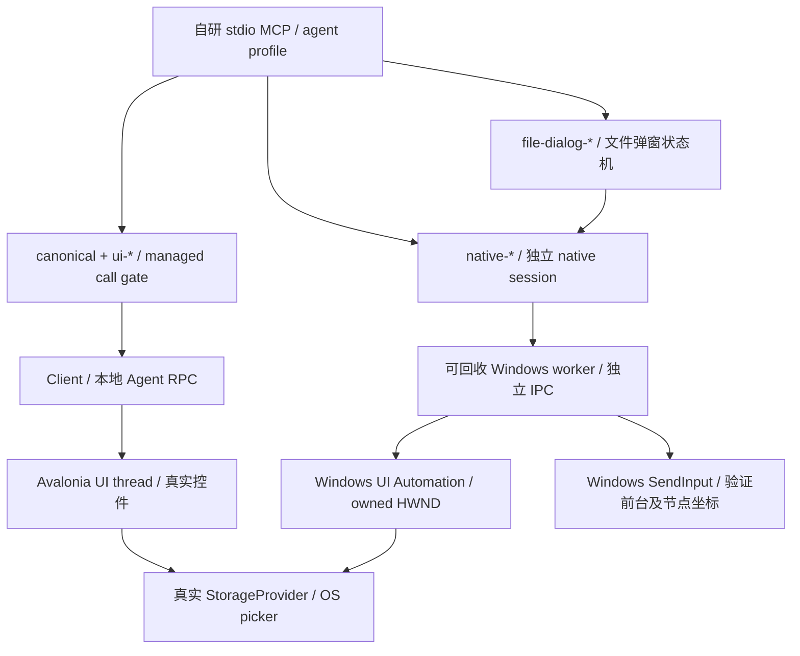

# Windows 完整界面交互与原生文件流程

核对日期：2026-10-25。本页定义新的用户目标和固定验收范围：自研 Agent 经 MCP 操作真实 Avalonia 桌面应用，并完成 Windows 原生文件选择及应用真实读写。工具注册、源码实现、headless 测试、真实桌面和真实 MCP 端到端是不同证据层级。旧的官方兼容验收结果不作为这个目标的完成率。

## 工具表面与执行层次

`AvaloniaDevTool.Cli mcp` 当前默认使用 `agent` profile。它在相同会话内注册 canonical 16 项工具和 `ui-*`、`native-*`、`file-dialog-*` 扩展。显式 `--profile official` 只注册 canonical 16，`--profile extended` 保留既有诊断表面。`attach-to-file` 是预览宿主，不是打开 OS 文件选择器；桌面文件验收应附加真正的 ClassicDesktopLifetime 应用。

canonical 16 为 `attach-to-app`、`attach-to-file`、`detach`、`tree`、`ancestors`、`search`、`screenshot`、`props`、`set-prop`、`styles`、`pseudo-class`、`resources`、`assets`、`open-asset`、`input`、`action`。它们继续承担发现、检查、属性、资源和兼容输入；新交互工具不把原生对象塞进 canonical 树。

实现入口：[`Program.cs`](../../../src/AvaloniaDevTool.Cli/Program.cs)、[`AgentTools`](../../../src/AvaloniaDevTool.Cli/AgentTools.cs)、[`OfficialTools`](../../../src/AvaloniaDevTool.Cli/OfficialTools.cs)、[`NativeAutomationSession`](../../../src/AvaloniaDevTool.NativeAutomation/NativeAutomationSession.cs) 和 [`NativeFileDialogController`](../../../src/AvaloniaDevTool.NativeAutomation/NativeFileDialogController.cs)。具体工具参数见[交互功能说明](../features/agent-interaction.md)。

## 并发和模态窗口

canonical 与 `ui-*` 通过 `OfficialTools._calls` 串行化；节点解码、目标会话检查及完成后的 content generation 检查都在这条调用链中。`ui-wait` 每次轮询分别调用 search/props，轮询间释放 managed gate。等待不是在持有该 gate 的情况下睡到业务完成。

`native-*` 和 `file-dialog-*` 不取得 managed gate，也不依赖正在等待的 managed RPC 返回。`ToolSession._nativeGate` 只管理 native 会话创建/替换，`NativeAutomationSession._requests` 串行化 worker 请求，文件控制器另有 `_mutationGate` 防止一组填写/确认动作彼此交错。因此，managed 点击同步进入 OS 模态循环时，native 请求仍有独立执行路径。最新边界批次中的NativeManagedGateMcpTests已验证：同一MCP进程的原始managed click和后续queued props均未完成期间，native仍能识别并关闭owned dialog，随后managed调用完成。

UIA Invoke 也可能被目标的模态回调阻塞。worker 对一般 pattern 操作保留 operation ID，快速返回 `pending`，后续由 `native-action-status` 查询；标准 Win32 按钮在核对 pattern/归属后投递标准按钮消息，返回 `dispatched`。这些状态只说明投递或 provider 操作进度，必须读取窗口、控件或业务状态确认结果。不要把 `pending`、`dispatched` 或弹窗关闭写成“文档保存成功”。

同一个目标 Agent 只接受一个诊断连接。应用操作和系统弹窗操作应使用同一 `agent` profile 的 managed/native 分支，避免第二个 MCP 服务争用目标连接。测试中也应避免两个驱动同时注入同一个桌面的输入。

## 节点身份、进程与 owner 边界

| 域 | 身份和过期条件 |
| --- | --- |
| canonical / `ui-*` | 使用公开的数值 nodeId，包含会话 epoch；附加目标或 content generation 改变后旧 ID 明确失败。只有通过当前 tree/search 获得的 ID 才能继续操作。 |
| `native-*` / file dialog | 使用 `native:<session>:<opaque-id>` 字符串，属于单个 worker/session；对话框 ID 和覆盖 prompt ID 来自这一域。不能传给 `ui-*`，也不能把数值 Avalonia ID 当作 native ID。 |

native 附加到当前本地 Agent 提供的 PID，并同时记录 UTC process start time。facade 每次发请求前核对目标身份；worker 也重复核对。仅 PID 相同不足以证明进程仍是原目标，PID 重用必须拒绝。

worker 的根窗口范围是目标进程自己的 HWND，以及沿 owner 链能回到目标进程的窗口，owner 遍历有界。记录每个根的 HWND、根进程 PID/start time 和 UIA runtime ID。解析旧节点时重新核对 owner 范围、窗口进程与 start time、根和节点 runtime ID，以及节点仍为该根后代。句柄复用、弹窗关闭、窗口替换、其他会话 ID 或移出归属范围都应报错，不按旧标题重新寻找一个替代目标。

跨进程 owned dialog 只有在可验证的 owner 根内才进入范围，子节点必须属于其记录的根进程。普通桌面窗口、其他应用窗口和没有 owner 关系的进程不自动纳入。`native-tree`/`native-find` 输出访问数量和截断标志；截断结果不能证明节点不存在。密码控件的值不作为普通文本返回。

## 可回收 worker

Windows worker 使用 FlaUI UIA3，通过独立 UTF-8 行式 IPC 与 facade 通信，不装载进业务应用。worker 部署在 CLI 的 `native-worker/` 下，缺失时明确失败。默认 facade 单次操作期限为 15 秒，可配置范围最多两分钟；UIA 连接/事务还有独立的较短超时。

请求超时、取消或 IPC 协议损坏时，会话失效并停止自己的 worker 进程树，调用路径不等待卡住的 provider 退出。旧 ID 不能复用；下次请求需重新获得 native 会话和树。detach、目标切换和 CLI 退出释放 worker。worker 另行周期核对目标和父 MCP 进程的 PID/start time，父进程或目标失效时退出。不能为回收 worker 而终止任意 UIA provider 或其他应用。

这些生命周期保证与真实交互是独立验收项：需要验证有界失败、旧 ID 被拒绝、可重新附加以及进程清理，不能仅检查 catch/Dispose 代码存在。

## 原生输入的实现状态

核对本页时，UIA pattern、native 枚举/检查、原生文件控制器及独立 `native-input` OS 输入路径已经接线到源码。修复阶段417项和当前常规统一回归均包含OS输入业务读回和真实MCP流程；不能把UIA SetValue或framework输入冒充OS输入，未覆盖分支仍保留。

OS 输入覆盖节点局部坐标上的 Click/DoubleClick/RightClick/Move/Wheel/Text/KeyChord/Drag：先验证 session、PID/start time、owner 根和节点，再激活根窗口、核对实际前台窗口；drag 目标必须在同一根，不接受任意全桌面坐标。执行前拒绝已按住的物理鼠标/修饰键，检查路径采样点未被其他根窗口遮挡；按下与释放在同一 SendInput 批次，部分投递失败时按成功count推算前缀，并尽力逐项释放仍按下项；清理再次被OS拒绝时不保证恢复状态。Unicode Text 只表示 Unicode 注入，不宣称 IME 组合输入；pointer drag 不宣称文件或数据 DragDrop。`Injected` 和 `InputCount` 是投递证据，`ApplicationEffectVerified` 默认 false。实现见 [CLI 注册](../../../src/AvaloniaDevTool.Cli/AgentTools.NativeInput.cs)、[合同](../../../src/AvaloniaDevTool.NativeAutomation/NativeAutomationContracts.cs)及 [worker 输入](../../../src/AvaloniaDevTool.NativeAutomation.Worker/NativeAutomationBackend.Input.cs)。当前实际效果和未覆盖分支分别按下方固定清单及最新批次记录，清理代码存在不代表已触发OS部分投递失败。

## 真实文件 I/O 验收目标

[`AutomationSample`](../../../samples/AvaloniaDevTool.AutomationSample/README.md) 是独立目标：真实 ClassicDesktopLifetime、多窗口和模态 owner；真实平台 StorageProvider；始终附加本项目 Agent，退出释放。没有 fake StorageProvider、定制 TopLevelProvider 或官方开发工具启动。构建产物和测试文件应放在唯一临时目录。

它的 `DocumentEditor`、`DocumentPath`、`SelectedFiles`、`FolderPath` 和 `FileStatus` 都有稳定 Name/AutomationId。Open 在完整 UTF-8 读取成功后才更新 UI，多选读取全部成功后再合并。Save 在 OS 选择器返回后实际写流，显式截断旧尾部、flush/关闭后才显示成功；`ShowOverwritePrompt=true` 使用真实 OS 覆盖确认。取消保持当前文档和已有文件不变，异常显示在 UI。

`--result-file` 在每次文件操作完成后原子写出 action、路径、cancelled、文档 content、UTF-8 byteLength、SHA256、status 和 error。该 hash 描述操作后编辑器内容。驱动还必须独立读取磁盘文件，并重新通过真实 Open 打开保存结果，才能证明保存正确。选择路径、API 回执、应用结果 JSON 和实际文件是四个不同证据。

文件控制器只描述和操作经过结构核对的 Windows common item dialog。`ApplicationIoVerified` 始终为 false；它不替应用证明读取或写入。覆盖需要新鲜 prompt ID、先前 existing SaveFile 目标及 owned Yes/No 结构；不自动回答其他确认框。拒绝覆盖通常回到 Save picker，还需要取消 picker 才结束应用的保存等待。

## 固定功能验收清单

以下 ID 是新目标的固定验收清单。每项记录实际通过/失败/未执行及证据批次；源码存在、构建通过、测试被跳过都不能标为真实 MCP 通过。当前579通过、0失败、1项Explicit未执行；表中“已验证核心”表示该行核心要求有实际效果证据，证据层级按补证文档区分，“部分验证”表示仍有具体分支未覆盖。二者不是代码工作量比例，不以测试总数抵扣未测条件，也不按清单行数推算整个产品完成率。

| ID | 必须观察的结果 | 当前状态 |
| --- | --- | --- |
| SESSION01 | 默认 `agent` 的真实 tools/list 包含 canonical 16 和独立交互扩展；`official` 仍只有 canonical 表面 | 已验证核心 |
| SESSION02 | attach、detach、目标切换后 managed/native 旧节点拒绝，目标关闭后连接和 worker 释放 | 已验证核心 |
| UI01 | 文本输入和 Enter 改变 InputStatus；中文文本保留 | 已验证核心 |
| UI02 | 单击次数准确，双击产生对应手势，右键打开实际 ContextMenu | 已验证核心 |
| UI03 | 组合键 down/up 成对，文本范围替换/删除生效，只读失败不改内容 | 已验证核心 |
| UI04 | ComboBox/ListBox/Tab 选择改变真实选中项和 SelectionStatus | 已验证核心 |
| UI05 | Invoke/Toggle/Expand/Collapse 使用真实控件 provider；不支持的 pattern 明确失败 | 已验证核心 |
| UI06 | 滚轮改变 LongScrollViewer 偏移，可访问并点击 ScrollItem60 | 已验证核心 |
| UI07 | 拖动保持 capture/坐标，DragStatus 达到 Dropped=True；跨根路径拒绝且释放输入状态 | 已验证核心 |
| UI08 | Popup/Flyout、普通/嵌套/右键菜单进入真实弹层树，动作及关闭状态正确 | 已验证核心 |
| UI09 | 第二窗口可枚举、编辑并独立关闭，owner 正确，关闭节点过期 | 已验证核心 |
| UI10 | 模态窗口禁用 owner，Accept/Cancel 结果准确，关闭后 owner 恢复 | 已验证核心 |
| UI11 | ui-wait 的 Exists/Absent/Equals/Contains 观察实际变化，歧义与超时明确失败 | 已验证核心 |
| UI12 | 隐藏/禁用/脱离树/无效坐标/失效 ID 的操作失败，业务状态未被误改 | 已验证核心 |
| NATIVE01 | 原生窗口列表包含目标和 owned modal，排除无归属的其他窗口 | 已验证核心 |
| NATIVE02 | tree/find/inspect 返回真实 UIA 属性、pattern 和截断状态，密码值不泄漏 | 已验证核心 |
| NATIVE03 | pattern 操作改变实际 Value/Toggle/Selection/Expand/Scroll/Window 状态；unsupported 明确失败 | 已验证核心 |
| NATIVE04 | managed 调用等待模态时，同一 MCP 的 native 分支能读取并回答 owned dialog | 已验证核心 |
| NATIVE05 | closed/replaced 窗口、其他 session、错误 start time/PID 重用均拒绝 | 部分验证 |
| NATIVE06 | worker 超时/取消后有界返回、回收和重新附加，不留下不可控后台进程 | 已验证核心 |
| NATIVE07 | OS Click/DoubleClick/RightClick/Move 在限定节点坐标产生实际效果 | 已验证核心 |
| NATIVE08 | OS Wheel 改变可观察滚动状态 | 已验证核心 |
| NATIVE09 | OS Unicode Text/KeyChord 改变文本/选择，结束后修饰键释放 | 已验证核心 |
| NATIVE10 | OS Drag 在同根移动目标，拒绝前台窗口不符/越界/跨根，并清理按压状态 | 部分验证 |
| FILE01 | 真实单选打开已知 UTF-8 文件，UI 身份/内容及结果路径一致 | 已验证核心 |
| FILE02 | 真实多选打开两个文件，实际选择数量/路径/全部内容一致 | 已验证核心 |
| FILE03 | 真实文件夹选择返回预期目录，文档内容保持不变 | 已验证核心 |
| FILE04 | 真实另存新文件，独立读取字节/长度/hash，再次通过 Open 验证 UI | 已验证核心 |
| FILE05 | 真实 OS 覆盖确认“是”，原长文件正确截断并可重新打开 | 已验证核心 |
| FILE06 | 覆盖确认“否”后取消 picker，原文件 hash、当前文档和路径均不变 | 已验证核心 |
| FILE07 | Open single/multiple、Folder、Save 四类取消均保持原状态和磁盘文件 | 已验证核心 |
| FILE08 | 文件类型名称/索引选择和读回准确，扩展名行为与实际输出文件一致 | 已验证核心 |
| FILE09 | 中文/空格绝对路径正确；相对路径、设备路径、ADS、通配符和不存在目标被拒绝 | 已验证核心 |
| FILE10 | 无权限/占用/非法 UTF-8 等真实 I/O 失败在 UI 和结果中可观察，不误报成功 | 已验证核心 |
| FILE11 | 多弹窗歧义、路径读回改变、树截断、stale prompt/timeout 均明确失败且无误操作 | 已验证核心（分层） |

## 证据批次与实际限制

本页初稿已执行：AutomationSample Release 构建，0 警告、0 错误，产物位于 `%TEMP%/AvaloniaDevTool-automation-sample-artifacts`。这仅证明新目标可编译，未计入上表任何桌面通过项。

相关测试入口包括 [`InteractionInspectionTests`](../../../tests/AvaloniaDevTool.Agent.Tests/InteractionInspectionTests.cs)、[`NativeAutomationIntegrationTests`](../../../tests/AvaloniaDevTool.NativeAutomation.Tests/NativeAutomationIntegrationTests.cs) 和 [`NativeFileDialogValidationTests`](../../../tests/AvaloniaDevTool.NativeAutomation.Tests/NativeFileDialogValidationTests.cs)。headless 可验证控件输入语义，Windows 原生集成可验证底层 provider/进程边界；它们都不自动覆盖“真实 stdio MCP → OS picker → 业务 I/O”的完整路径。真实桌面条件不满足时的 skip 必须保留为未验证。

后续批次应附：时间、OS/目标构建版本、唯一 pipe、目标 PID/start time、实际 tools/list、工具调用/返回、对应清单 ID、UI 状态与失败截图、结果 JSON、独立文件长度/hash、重新打开结果、TRX 或驱动日志、进程清理结果。未附对应结果证据的分支继续保持未验证，不推算完成率。

Windows native 后端只支持当前机器已附加的本地进程，拒绝 remote transport。macOS/Linux 没有对应 native backend；不能把 Windows 通过写成跨平台通过。framework 输入不是 OS 键鼠、IME 或系统文件 DragDrop；原生输入也不能绕过 Windows 前台、权限级别、交互桌面及 provider 限制。自绘控件可能不提供 UIA pattern，common dialog profile 不匹配时应失败并保留诊断信息。

该目标交付交互和可复现验收基础，不自动代表任意业务流程、通用测试编排器或性能发版门禁已经完成。新业务流程仍需定义自己的可观察结果、失败处理与通过阈值。

## 2026-10-25修复阶段历史批次与当时缺口

修复阶段22项目Debug/Release零警告零错误；Debug统一417/417通过，0失败0跳过。绑定305个源码输入、DLL与TRX的证据见 [native-fixed结果](../verification/2026-10-25-native-fixed.json)。双击/焦点修正及证据边界见 [修复记录](../research/native-input-fixes.md)。本段和下方当时缺口只保留为历史，当前状态以随后的边界补证批次为准。

当时部分验证的具体缺口：SESSION02原生旧ID跨ToolSession切目标/worker独立PID退出；UI07异常/cross-root拖动的MCP失败分支；UI08菜单动作后树关闭状态；UI12隐藏/脱离树/零布局的MCP分支；NATIVE01外部无owner进程排除；NATIVE02密码屏蔽/pattern列表；NATIVE03窗口状态/Scroll pattern和pending完成状态；NATIVE04受控managed gate持续占用；NATIVE05真实PID/HWND重用；NATIVE06inflight取消/父进程退出及worker PID回收；NATIVE07独立Move业务位置断言；NATIVE09OS释放状态独立断言；NATIVE10遮挡/部分投递后的按压清理；FILE08默认补扩展；FILE10权限/占用/保存失败；FILE11多picker歧义/外部路径变化/截断/stale prompt/超时。后续已补证项见下一节；已实现的安全拒绝不等于这些分支已经全部实测。

## 2026-10-25边界补证历史批次（459项）

该批次318个输入指纹对应的统一结果为459/459通过，0失败0跳过；22项目Debug/Release零警告零错误。证据见 [boundary-verified结果](../verification/2026-10-25-boundary-verified.json) 和 [补证分层](../research/windows-boundary-coverage.md)。417项及上述较早的16项部分验证清单是历史状态，不能据其判断最新缺口。

新增真实证据覆盖：完整39工具集合、MCP输入拒绝/清理恢复、菜单/弹层从树消失（Headless层）、native跨目标旧ID拒绝与worker OS退出、密码和pattern集合、Scroll/Window状态、pending完成/失败、真实managed gate阻塞期间native可用、父进程异常/取消/超时回收、OS修饰键释放、缺省扩展、读写占用/ACL失败和恢复、外部改名/旧prompt拒绝、匹配但截断的picker拒绝。合成慢provider只证明RPC与可见性超时隔离，不冒充真实UI。

当时仍部分验证的3行：NATIVE05未做真实PID/HWND循环复用；NATIVE10未强制造成OS部分插入失败并验证残留按压状态；FILE11多picker歧义及SetValue立即读回不一致尚缺实际样本（外部后改名、树截断、stale prompt和timeout已经通过）。这不是整个产品的完成率，跨平台/IME/文件DragDrop/通用验收门禁继续见状态文档。

## 2026-10-25输入与弹窗边界历史批次（467项）

该历史批次322个输入的统一结果为467/467通过，0失败0跳过；22项目Debug/Release零警告零错误，source drift=0，测试自有运行进程残留为0。源码指纹、14个DLL哈希和6份TRX见 [input-final结果](../verification/2026-10-25-input-final.json)。459项和417项均是此前源码的历史批次。

本轮增加8项：真实同PID双CommonItemDialog的歧义和显式ID操作隔离（SDK/controller + UIA worker）；合成provider的两种慢请求等待超时及路径立即读回不一致；模拟sender的4项输入清理测试（含32个失败前缀）。各层实际证明的行为见 [边界补证](../research/windows-boundary-coverage.md)，不把合成provider/sender写成真实OS故障。

FILE11核心分支现有分层证据；尚未做MCP双picker端到端样本。仍部分验证的两行是NATIVE05（实际PID/HWND循环复用）和NATIVE10（强制OS部分发送失败及实际残留按压状态）。输入清理已经加强并用模拟sender验证，但Win32仅返回成功count，按前缀推断和cleanup均为最佳努力，无法保证OS再次拒绝时恢复状态。原版许可运行等价、跨平台native、IME、文件/数据DragDrop和通用发版门禁仍按各自范围保留未完成。

## 2026-10-25窗口身份与文件类型历史批次

326个输入对应整批477通过、1失败、1项Explicit未执行；失败的窗口切换测试随后在相同源码/产物下独立复测80/80通过，整批失败仍保留。完整HWND复用实验NotExecuted不能计为通过。22项目Debug/Release零警告零错误，source drift=0，自有运行进程残留0。源码、DLL/TRX哈希和逐项outcome见 [agent-ui-final结果](../verification/2026-10-25-agent-ui-final.json)。中间保存类型下拉失败和各次预算失败均保留，未改写历史成全绿。

窗口身份防护在cache key纳入PID/start time及根/节点epoch，按进程订阅销毁通知，读取/遍历/投递前后校验，确认stale后永久退役。真实父销毁使旧根和旧子节点都失效，不要求每个子有独立通知；异步窗口和无HWND provider限制见 [研究](../research/native-window-identity.md)。文件类型单次回退只允许completed+Collapsed+唯一直接DropDown/Invoke，9项合成provider正/负测试和真实MCP文件流程分别保留层次。

NATIVE05仍部分验证：实际HWND复用红样本已取得，但修复后完整复用拒绝尚未验证通过，实际PID循环未触发。NATIVE10真实OS部分发送失败/清理仍未触发。FILE11分层证据和MCP双picker端到端缺口继续保留；官方许可对照、跨平台native、IME、文件/数据DragDrop和通用发版平台没有因常规测试通过自动完成。

## 最终能力提供方范围与结果

当前默认44项工具，最新独立完整批次579通过、0失败、1项Explicit未执行，22项目Debug/Release零警告零错误、340输入无漂移。结果、源码指纹及逐项证据见[capabilities-final](../verification/2026-10-25-capabilities-final.json)与[能力证据审计](../verification/2026-10-25-capability-audit.json)。本节取代早期477/1/1等状态作为当前记录。

现范围只提供操作、读取、PNG和原始诊断，由调用方做业务判断；早期场景/验收平台设计不再是待完成要求。官方许可对照、跨平台native、完整CPU/内存剖析、IME候选和文件/数据DragDrop均按用户决定排除，见[当前范围](current-agent-scope.md)。

35行历史能力清单的部分验证标记继续保留具体证据边界：实际PID循环、强制OS部分输入故障、修复后完整HWND循环复用等没有变成已通过。普通窗口/旧ID/超时/取消和代表性UI、真实文件、原生截图能力已经验证；工具不承诺覆盖任意渲染器、provider或与用户同时争用输入的情形。

后续显式补证（2026-10-25）：完整根HWND复用实验已独立1/1通过，32,766轮/61,173ms后原句柄593860被新窗口使用；旧根/子节点读取及后续写入/聚焦均拒绝，新内容不变。该结果不改写之前常规回归的1项未执行。动作发生在失效读取之后、异步通知非原子屏障等限制仍保留，参见[显式记录](../verification/2026-10-25-hwnd-reuse-verified.json)。
