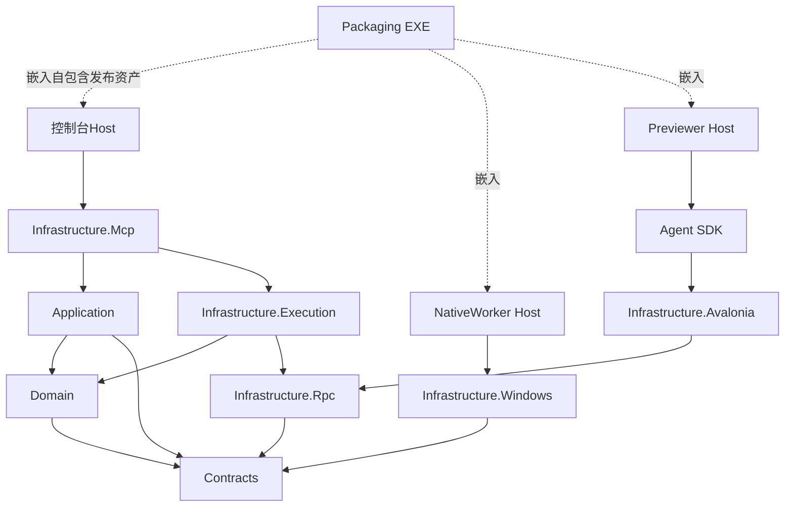
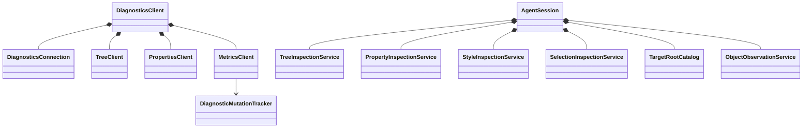
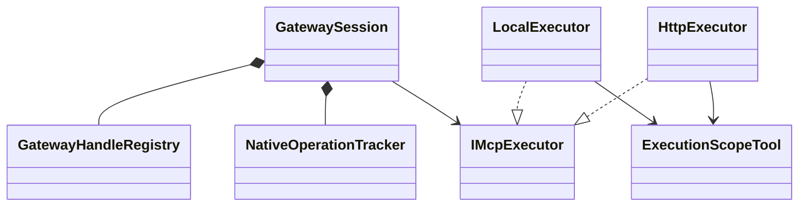

# 能力域与解决方案架构

源码以全解决方案的一套分层组织。十个能力域是功能所有权边界，不是十套重复的 Contracts/Domain/Infrastructure，也不要求每个工具创建一个工程。

统一入口是 `AvaloniaDevTool.exe mcp`，Codex 只使用 stdio；内部由 LocalExecutor 或 HttpExecutor 选择执行电脑。`serve` 是被测电脑上的直接执行 Console。打包工程将控制台、预览器和原生 worker 作为自包含资产嵌入单 exe。

## 分层和实际项目

| 层 | 实际职责 |
| --- | --- |
| Contracts | 目标、树、属性、资源、输入、图片、诊断、native及预览的中立DTO与能力端口；不含框架或MCP依赖 |
| Domain | 真实可独立的规则与状态：文件选择流程、诊断采集变更归属；不为了填充目录创建空领域服务 |
| Application | 跨诊断来源的采集编排，通过IDiagnosticCaptureClient端口操作当前连接；不引用MCP或执行实现 |
| Infrastructure.Rpc | 帧、管道RPC、序列化和trace，输出真实Infrastructure.Rpc程序集 |
| Infrastructure.Execution | 17组客户端能力对象、连接和native worker客户端；调用方直接引用真实执行工程 |
| Infrastructure.Avalonia | 目标内独立能力服务、原始对象身份/观察、根发现、框架版本适配 |
| Infrastructure.Windows | UIA、原生身份、查询、动作、输入和截图，Windows依赖只留此层 |
| Infrastructure.Mcp | 唯一能力工具目录、网关、两个执行器、结果和句柄映射、HTTP执行宿主 |
| SDK | 只保留真实Agent公开接入入口；旧Client/NativeAutomation兼容SDK已删除 |
| Hosts | 控制台Program、Previewer、NativeWorker的进程入口与组装 |
| Extensions | 可选日志与Agent WebSocket传输，核心不依赖这些扩展 |
| Packaging | 独立单文件bootstrap、资产清单、解包与子进程所有权 |

准确的csproj引用和项目数由[项目清单](architecture/project-inventory.md)给出。解决方案同时列出tools、打包脚本、文档和根构建配置。

## 编译和运行关系

虚线为构建/打包关系。控制台不编译引用Avalonia或UIA；打包启动子进程也不把进程合并为同一个运行环境。

## 能力对象和生命周期

AgentSession只组装、分发与释放。树拥有分支观察、版本和MergedTree；属性拥有覆盖、预览租约、上下文与变化合批；样式拥有伪类覆盖；选择拥有拾取/焦点事件。公共观察只报告原始变化，根目录区分配置根和包含弹层的呈现根。

DiagnosticsClient只保留连接、会话及能力组合，调用方使用Tree、Properties、Input、Resources、Assets、Rendering、Metrics等能力对象。连接不再声明所有领域事件；各能力订阅自己的通知。诊断变更tracker属于Domain的诊断所有权，不塞入通用RpcPeer。

## 统一MCP网关

IMcpExecutor是MCP外层适配，不是Application的万能工具名/JSON接口。LocalExecutor调用同一执行目录，HttpExecutor只调用已选择的远端会话；远端不再次选择机器。

ExecutionScopeTool包装执行结果的内部元数据，供网关确认目标/内容/native会话范围；它不增加用户工具。执行目录88项，网关增加select-machine共89项。外部句柄由网关分配，后端ID只作不透明映射。结果映射只处理已知工具的已声明字段，不扫描修改采集记录里的任意业务JSON。

图片保持image内容和原元数据，仅身份字段转换。机器切换、断线、目标切换及文档成功重载分别退休对应范围；不能把仅内容重载扩大成废掉整段采集。

## 分发与验证

- [打包和安装](packaging-and-installation.md)：真实单exe工程、.local版本目录及用户PATH。
- [MCP用法](mcp.md)：默认本地、选择IP、远端Console、历史入口。
- [迁移记录](architecture/refactoring-blueprint.md)：旧大partial的实际归属。
- [扩展能力](architecture/extending-tools.md)：复用能力对象、契约和共享执行目录。
- [运行约束](architecture/runtime-contracts.md)：身份、并发、恢复和预算。
- [测试说明](testing.md)：本机Local和回环HTTP、媒体、切换、打包分别列证据。
