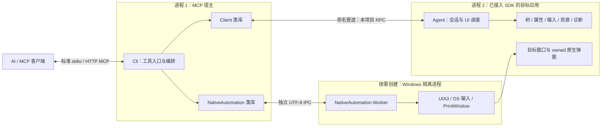
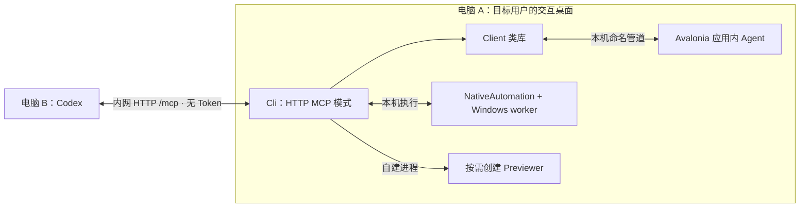
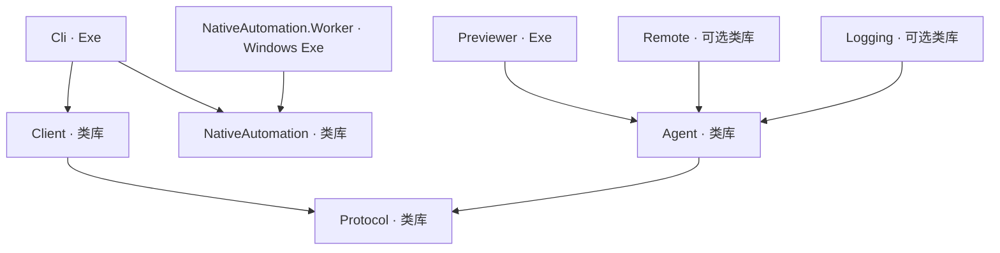
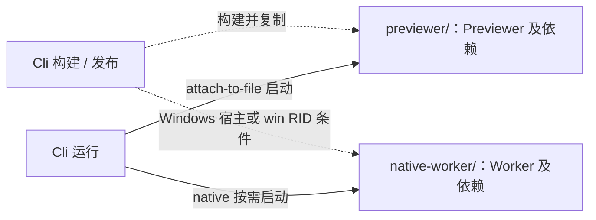
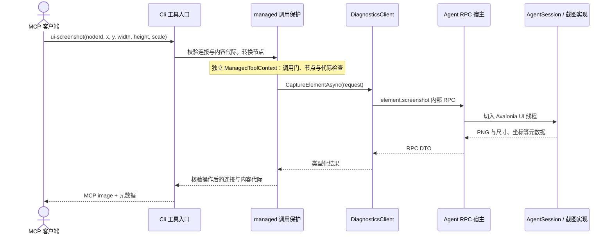
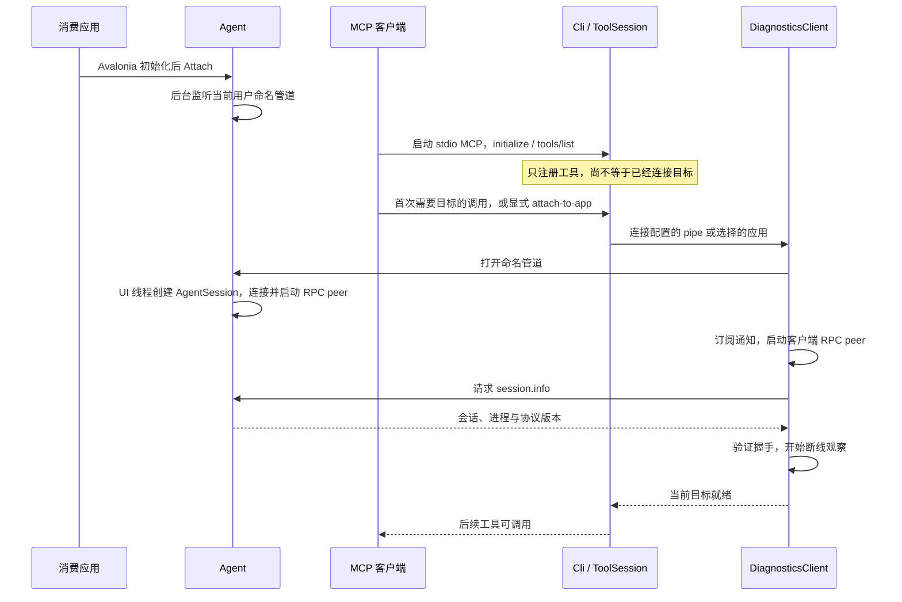
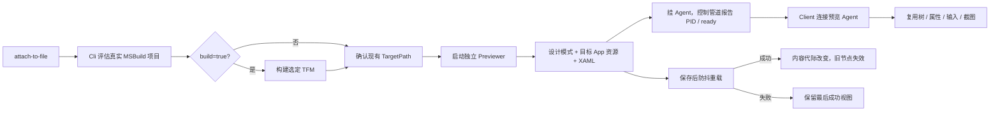

# 项目架构导航

AvaloniaDevTool 由目标应用内 Agent、独立 MCP 宿主和 Windows 原生隔离 worker 组成。工具按能力扩展，连接、协议、对象身份和生命周期提供公共支撑。

**本页描述当前实现。** 九个生产项目已按领域归目录，Agent 的同步 RPC 按领域注册；MCP 宿主提供 stdio 与内网 HTTP。`OfficialTools / AgentTools / InspectorTools` 保留为兼容聚合壳，共享基础设施已提取到独立上下文。

| 想知道什么 | 阅读入口 |
| --- | --- |
| 一眼看全局、切换项目与领域 | [离线架构图](architecture/overview.html)、[部署静态图](architecture/assets/lan-overview.png) |
| Codex 与 Avalonia 不在同一台电脑 | [内网双机部署](architecture/lan-mcp-design.md)、[部署图](architecture/overview.html#lan) |
| 每个项目引用谁、22 个项目各做什么 | [项目清单与依赖](architecture/project-inventory.md) |
| 领域怎么划分、文件放哪里、谁释放资源 | [结构与重构记录](architecture/refactoring-blueprint.md) |
| 新增一个工具到底要改哪些位置 | [工具扩展指南](architecture/extending-tools.md) |
| 已复现的框架、输入与网络限制 | [当前限制](architecture/limitations.md) |
| 协议、节点、并发、预算和失败的详细约束 | [运行契约与边界](architecture/runtime-contracts.md) |
| 当前产品能力范围与验证入口 | [能力范围](agent-tools/architecture/current-agent-scope.md)、[测试说明](testing.md) |

## 三十秒理解项目

1. **Agent 是消费应用引用的 SDK。** 应用完成 Avalonia 初始化后调用 `DiagnosticsAgent.Attach`，才能接受 managed 诊断操作。
2. **Cli 是 MCP 服务进程。** 本机客户端可通过 stdio 启动；另一台电脑的 Codex 可通过配置的 HTTP URL 连接已运行的宿主。
3. **Client 是类型化类库。** 它在 Cli 等调用方内部使用，通过本项目 RPC 连接 Agent，不是另一个进程。
4. **Windows 原生操作有独立通道。** NativeAutomation 类库启动 worker，通过 UIA/OS API 操作已附加应用及可验证的 owned 窗口。
5. **Previewer 为 XAML 创建目标进程。** 它挂载同款 Agent，后续 managed 操作继续复用 Client/RPC。

解决方案共有 **22 个项目：9 个生产项目、3 个样例、6 个测试项目、4 个测试支撑项目**。生产项目中 6 个是类库，3 个是可执行宿主。目录数量不等于进程数量。

## 运行全景

下面的箭头表示运行时调用或通信，不表示 C# 项目引用。预览与可选扩展在后面的图中单独说明。



managed 操作进入目标 Avalonia UI 线程；Metrics/Activity 等后台监听和合成采集仍保留各自线程边界。native 不经过目标 Agent，也不占用 managed 调用 gate。因此 managed 点击等待模态窗口时，native 仍能读取和处理弹窗。

Remote 是可选 WebSocket 接入，认证后复用 Agent 的同一会话入口；Logging 是可选 `ILoggerProvider` 适配。核心 Agent 不依赖 ASP.NET Core 或 Microsoft 日志框架。

## 内网双机部署

主要使用方式是：Codex 在电脑 B，被测 Avalonia 应用、MCP 执行宿主、worker 和 Previewer 在电脑 A。首版外层采用内网 HTTP Streamable MCP，不配置 Token、OAuth 或证书；内部仍复用 A 上的管道与 worker IPC。该入口已实现，并完成本机、真实 Codex 和 WSL 跨系统专项；独立两台电脑的 LAN 还需现场验证。



IP 可以配置，但配置层次不同。以下 `192.168.1.50:7443` 是可替换示例，不表示该地址上常驻运行了服务：

| 层次 | 示例 | 含义 |
| --- | --- | --- |
| A 上的宿主启动参数 | `mcp --transport http --listen 192.168.1.50 --port 7443` | 选择 A 的监听网卡和端口；`/mcp` 固定 |
| B 上 Codex 的 MCP 配置 | `url = "http://192.168.1.50:7443/mcp"` | Codex 使用 A 的可达地址建立标准 MCP 连接 |
| MCP 工具业务参数 | `nodeId`、应用 `id`、A 上的工程/文件路径 | 建立 MCP 连接后不再逐次传 IP |

Codex 的 HTTP 条目直接使用 `url`，按正常 MCP 配置加载并连接 A 上已运行的服务；不配置本地 `command/args` 或 Token，也不要求手工调用连接工具。若 A 绑定 `0.0.0.0`，B 仍填写 A 的真实可达 IP；B 的 `localhost` 指向 B 自己。

HTTP 首版复用默认 `agent` 的 44 项工具；现有 `official/extended` 仍保留原 stdio 用法，首版不通过 HTTP 暴露这些历史目录。这样先验证完整自动化主路径，再处理旧目录的不同身份和契约。

HTTP 请求作用域不能代替长期目标控制会话。首版显式选择有状态模式并验收实际 Codex 的协议协商，按逻辑控制会话持有 ToolSession；租约到期、会话终止或宿主退出时清理自有资源。MCP 会话 ID 只做状态关联，不是登录凭据。具体接口、生命周期与验证范围见[内网双机部署](architecture/lan-mcp-design.md)。

## 项目职责与编译依赖

名称省略统一前缀 `AvaloniaDevTool.`。这张图只画直接 `ProjectReference` 编译引用，箭头为“使用方 → 被引用方”。



| 项目 | 核心职责 | 内部边界 |
| --- | --- | --- |
| [Protocol](../src/AvaloniaDevTool.Protocol/AvaloniaDevTool.Protocol.csproj) | DTO、方法名、通知、RPC、JSON 元数据、协议 trace | 不引用 Avalonia、MCP、UIA |
| [Client](../src/AvaloniaDevTool.Client/AvaloniaDevTool.Client.csproj) | 连接、握手、类型化调用、通知与断线 | 不承担目标内 UI 操作或 MCP 输出格式 |
| [Agent](../src/AvaloniaDevTool.Agent/AvaloniaDevTool.Agent.csproj) | 目标内功能、对象身份、临时修改与监听 | 框架版本差异集中在适配器 |
| [Cli](../src/AvaloniaDevTool.Cli/AvaloniaDevTool.Cli.csproj) | MCP 宿主、工具契约、附加、预览和采集编排 | Hosting/Catalog/Sessions/Tools 分离，工具共享窄调用上下文 |
| [NativeAutomation](../src/AvaloniaDevTool.NativeAutomation/AvaloniaDevTool.NativeAutomation.csproj) | native DTO、worker 客户端、文件弹窗控制器 | 保持 net10.0，UIA 与 WinForms 留在 worker |
| [NativeAutomation.Worker](../src/AvaloniaDevTool.NativeAutomation.Worker/AvaloniaDevTool.NativeAutomation.Worker.csproj) | Windows UIA3、输入、截图、窗口身份 | 独立进程、独立 IPC 与失败回收 |
| [Previewer](../src/AvaloniaDevTool.Previewer/AvaloniaDevTool.Previewer.csproj) | 设计模式、程序集和 XAML 加载、文件监视与重载 | 内部挂载 Agent；不调用目标应用 Main |
| [Remote](../src/AvaloniaDevTool.Remote/AvaloniaDevTool.Remote.csproj) | WebSocket 监听、认证和接入 | 复用 Agent 会话，不创建另一套功能服务 |
| [Logging](../src/AvaloniaDevTool.Logging/AvaloniaDevTool.Logging.csproj) | 将应用 ILogger 接入诊断日志源 | 应用拥有 provider，诊断会话拥有订阅 |

Cli 还需要两个运行资产，但不把它们编译为自己的程序集依赖：



两个 `ProjectReference` 的 `ReferenceOutputAssembly=false` 表示不参与 Cli 编译引用，仍需构建和分发。worker 编译引用 facade，而 facade 在运行时启动 worker，这不是编译循环。具体条件与复制目标以 [Cli.csproj](../src/AvaloniaDevTool.Cli/AvaloniaDevTool.Cli.csproj) 为准。

## 领域如何贯穿项目

领域按能力划分。一个领域可以有 Protocol 契约、Client 代理、Agent 实现和 MCP 入口；这些代码运行在不同位置，因此保留各项目边界，用一致的领域名称建立对应关系。

| 能力域 | 执行位置 | 主要支撑能力 |
| --- | --- | --- |
| 连接与目标 | Cli + Client + Agent 宿主 | 发现、握手、目标身份、附加切换与断开 |
| 树与搜索 | Agent；Cli 适配契约 | 三类树、分页、selector、分支观察、节点元数据 |
| 属性与样式 | Agent | 绑定信息、上下文属性、值与 XAML 转换、Brush、覆盖恢复 |
| 资源 | Agent | 字典与键身份、来源、查询、临时修改及冲突恢复 |
| 资产 | Agent；Cli 编排读取/输出 | 预览、完整导出、分块、hash、流与过期回收 |
| 框架输入 | Agent | 指针、键盘、焦点、选择与 provider 动作 |
| 截图与视觉诊断 | Agent；native 截图在 worker | 坐标和像素预算、布局、合成、覆盖层、渲染状态与弹层冻结 |
| 原始诊断 | Agent；Cli 协调采集 | Logs/Events、Metrics、样式/资源 Profiler、Breakpoints |
| 运行时检查 | Agent | CLR 公共成员、集合分页、复杂值弱引用下钻 |
| 原生窗口与输入 | NativeAutomation + worker | PID/start time、owner、UIA 身份、OS 输入、操作状态 |
| 文件弹窗 | NativeAutomation 控制器 + worker | 弹窗结构、路径、过滤器、确认、取消与覆盖处理 |
| XAML 预览 | Cli 编排 + Previewer | 项目评估、可选构建、App 上下文、加载、监视、重载 |

`OfficialTools / AgentTools / InspectorTools` 是当前入口的历史组织方式，不是目标领域。其公共机制已提取、功能按目录归域，旧公开类型继续承载兼容契约；同名工具存在参数和语义差异，不能靠改名自动合并。

## 当前文件夹

当前根目录的角色如下。完整项目清单见[项目清单](architecture/project-inventory.md)，各生产项目的实际目录及迁移映射见[结构与重构记录](architecture/refactoring-blueprint.md)。

```text
AvaloniaDevTool/
├─ AvaloniaDevTool.slnx       22 个项目的解决方案
├─ Directory.Build.props     net10.0、Avalonia 版本与统一编译规则
├─ global.json               SDK 约束
├─ src/                      9 个生产项目
├─ samples/                  3 个 SDK 消费与真实交互样例
├─ tests/                    6 个测试项目、4 个支撑项目和 AOT 脚本
├─ docs/                     当前契约、架构、使用说明与历史研究
│  ├─ architecture.md        本页
│  └─ architecture/
│     ├─ overview.html       可点选的离线架构图
│     ├─ project-inventory.md
│     ├─ refactoring-blueprint.md
│     ├─ extending-tools.md
│     ├─ lan-mcp-design.md
│     └─ runtime-contracts.md
├─ artifacts/                本机验证产物，非生产代码
└─ .codegraph/               本机代码索引，非产品模块
```

本轮采用“保留项目，项目内按机制和领域拆分”：Protocol 管契约与通信，Agent 管目标内执行，Client 管调用代理，Cli 管 MCP 与流程编排。公共技术机制集中，属性转换、资源恢复、文件过滤等领域规则留在各自模块；不新增包揽一切的 Common 项目。

## 一次调用怎么工作

以现有 `ui-screenshot` 为例，工具入口、Client 和 Agent 服务各负责一段明确工作。



源码顺序：[MCP 工具](../src/AvaloniaDevTool.Cli/Tools/Rendering/AgentTools.Screenshot.cs) → [Client 方法](../src/AvaloniaDevTool.Client/Features/Rendering/DiagnosticsClient.Screenshots.cs) → [协议契约](../src/AvaloniaDevTool.Protocol/Contracts/Tree/ExplorationContracts.cs) → [UI 调度](../src/AvaloniaDevTool.Agent/Hosting/DiagnosticsAgent.cs) → [RPC 分发](../src/AvaloniaDevTool.Agent/Features/Tree/AgentSession.Exploration.cs) → [PNG 实现](../src/AvaloniaDevTool.Agent/Features/Rendering/AgentSession.Screenshot.cs)。

## 项目怎么启动起来

仓库约束为 .NET 10 SDK（`global.json` 指定 10.0.100，允许 latestFeature roll-forward），框架版本见 `Directory.Build.props`。Windows native 需要交互桌面；可见样例与预览也需要桌面环境。

先在仓库根目录构建。以下命令把产物放进临时目录，不会迁移源码目录：

```powershell
$buildRoot = Join-Path $env:TEMP 'AvaloniaDevTool-architecture'
dotnet build AvaloniaDevTool.slnx -c Debug --artifacts-path $buildRoot
```

构建成功后，在一个独立终端启动真实目标：

```powershell
$buildRoot = Join-Path $env:TEMP 'AvaloniaDevTool-architecture'
$sampleDll = Join-Path $buildRoot 'bin/AvaloniaDevTool.AutomationSample/debug/AvaloniaDevTool.AutomationSample.dll'
dotnet $sampleDll --pipe avalonia-devtool-demo
```

然后配置 MCP 客户端以 stdio 子进程方式执行下面的命令。可以在终端启动查看错误，但工具调用由 MCP 客户端通过协议发送：

```powershell
$buildRoot = Join-Path $env:TEMP 'AvaloniaDevTool-architecture'
$cliDll = Join-Path $buildRoot 'bin/AvaloniaDevTool.Cli/debug/AvaloniaDevTool.Cli.dll'
dotnet $cliDll mcp --pipe avalonia-devtool-demo
```

启动与附加的职责顺序：



省略 `--pipe` 时，先调用 `attach-to-app {}` 发现目标，再使用返回的应用 `id` 选择；该 ID 不是约定的操作系统 PID。标准输出只承载 MCP，日志写标准错误。更多调用配置见 [MCP](mcp.md)。

## 文件预览怎么接入同一条链路



CLI 拥有自建预览进程，Previewer 拥有程序集加载、文档与 watcher。detach、切换、失败和父 MCP 失联需要释放对应自有资源。外部附加应用不归 CLI 所有，不会因此终止。

## 怎么扩展

先判断新增内容属于哪一种，再进入对应路径：

| 新需求 | 改动主线 | 不必重新实现 |
| --- | --- | --- |
| 组合已有能力，例如等待某个条件 | MCP 工具/编排 + 对应测试和说明 | Agent、RPC、对象注册 |
| 目标内新增操作 | Protocol 契约/JSON 元数据 → Agent 处理 → Client 代理 → MCP 入口 | 连接、UI 调度、节点身份、通用错误转换 |
| Windows native 新能力 | facade 契约/调用 → worker 执行 → MCP 入口 | managed RPC 与 Agent 服务 |
| 新 Avalonia 版本适配 | 框架适配器与真实消费验证；必要时调整能力声明 | 无变化的 MCP 契约和通用通信 |

详见[扩展指南](architecture/extending-tools.md)。采用编译时注册的内置功能模块；保留 MCP SDK 的工具特性与注册机制，不引入动态 DLL 插件加载。

扩展是否完成，要看新增能力在正确执行位置工作、契约可调用、资源能释放、失败有界；不能只看 `tools/list` 中出现了一个名字。

## 从哪里读代码

| 要理解的内容 | 当前入口 |
| --- | --- |
| MCP 参数、profile 和工具注册 | [Cli/Program.cs](../src/AvaloniaDevTool.Cli/Hosting/Program.cs) |
| 目标连接和自建预览管理 | [ToolSession.cs](../src/AvaloniaDevTool.Cli/Sessions/ToolSession.cs) |
| 应用如何挂载 SDK | [DiagnosticsAgent.Attach](../src/AvaloniaDevTool.Agent/Hosting/DiagnosticsAgent.cs) |
| 连接对应的 Agent 会话 | [DiagnosticsAgent.Transport.cs](../src/AvaloniaDevTool.Agent/Hosting/DiagnosticsAgent.Transport.cs) |
| 目标内请求分发 | [AgentSession.cs](../src/AvaloniaDevTool.Agent/Sessions/AgentSession.cs) |
| 类型化连接与握手 | [DiagnosticsClient.cs](../src/AvaloniaDevTool.Client/Connections/DiagnosticsClient.cs) |
| 内部帧、请求关联与超时 | [RpcPeer.cs](../src/AvaloniaDevTool.Protocol/Transport/RpcPeer.cs) |
| native 隔离进程管理 | [NativeAutomationSession.cs](../src/AvaloniaDevTool.NativeAutomation/Sessions/NativeAutomationSession.cs) |
| XAML 预览宿主 | [Previewer/Program.cs](../src/AvaloniaDevTool.Previewer/Hosting/Program.cs) |

## 重构范围与验证

结构、领域归属、所有权和迁移结果见[结构与重构记录](architecture/refactoring-blueprint.md)。本轮保持实际能力，逐项处理公开 C# API、内部 wire 方法和外部 MCP 契约；文件或 CLR 类型改名不要求同时修改 wire 字符串。

生产实现与样例/fixture 分开；协议测试、目标内测试、真实 stdio 测试、native 桌面测试、预览测试和 AOT 消费各保留自己的证据。具体命令和验证边界见[测试说明](testing.md)。本页的运行命令是复现入口，历史测试数量不代表本次执行结果。
