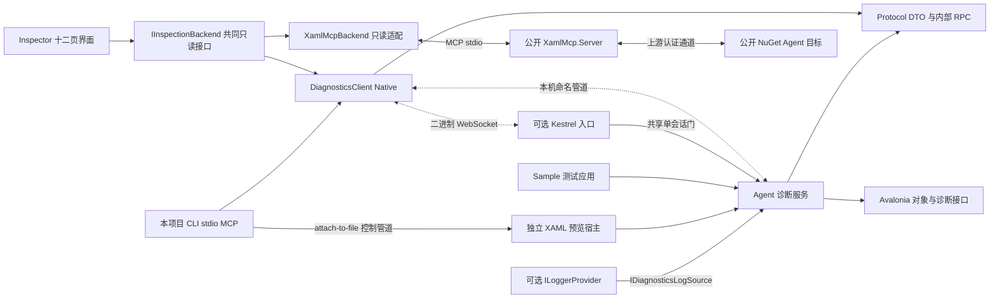

# 架构与协议

Native 模式由应用内 Agent 访问真实 Avalonia 对象，DiagnosticsClient 提供诊断 API，Inspector 和本项目 stdio MCP 共用它。Inspector 的共同只读路径另抽象为 IInspectionBackend，已接入公开 NuGet XamlMcp Server／Agent；Native 高级能力继续由 DiagnosticsClient 提供。独立 Previewer 仍是接入 Native Agent 的目标。

## 模块与依赖

Protocol 不引用 Avalonia。跨进程消息传递 DTO、文本预览和弱对象 ID，不序列化业务 CLR 对象图。Avalonia 对象访问在目标 UI 线程执行；日志、Meter 和 Activity 的后台回调先进入各自的有界缓冲区，再通过服务发送快照和通知。Profiler 回调只保留有界基本类型描述，不访问弱对象注册表。

MCP 是外部标准协议层，由官方 C# SDK 承载；Native 内部管道使用本项目的长度前缀 JSON RPC。XamlMcpBackend 经标准 MCP 调用上游 Server，不实现或复制其认证 wire。这些协议层不同，不伪装为原版 DeveloperTools 的 CoreRPC。

## 共同接口与后端能力

IInspectionBackend 位于 Client，包含连接／断开、根和子节点、属性、样式、祖先路径及 PNG 读取。BackendId、HasStableObjectIds、HasPushUpdates 和 LastNotice 表达后端差异；Native 修改和采集方法继续由 DiagnosticsClient 提供。

| 范围 | Native | XamlMcp 公开包适配 |
| --- | --- | --- |
| 目标 | 本项目 Agent | XamlMcp.Avalonia 1.0.0-preview.3，不需要本项目 Agent |
| 传输 | 本项目 RPC：命名管道或可选 Native WebSocket | SDK stdio → XamlMcp.Server 1.0.0-preview.3 → 上游认证通道 |
| 对象身份 | 会话内稳定弱 ID | 每次根刷新更换本地句柄，绑定上游 snapshotId／nodeId |
| 树与更新 | Visual／Logical／Merged 懒加载、失效通知 | Visual／Logical 有界预取快照、缓存展开；Merged 返回 unsupported_tree，无 push，用户显式刷新 |
| 编辑与高级服务 | Native 编辑、观察、只读对象页及 Activity Profiler | 只读共同子集，其余命令／页面提前禁用 |
| 缺失诊断 | 显式 Limitations | 保留 provenance／gaps，Unknown／null 不补成假值 |

外部快照默认 2048 节点、深度 24；截断分支返回 snapshot_truncated，不伪装为空叶子。Visual 祖先使用上游接口，Logical 祖先只来自当前 logical 缓存。刷新或切换树时清除旧选择、属性、样式和截图；snapshot_expired 与 tree_scope_mismatch 保持明确区别。

Backend 项目固定下载公开 Server 载荷并复制到输出的 Upstream/XamlMcpServer，保留许可和归属文件。Inspector 启动时显式选择后端和绝对 Server 路径。实际兼容证据限定于公开 1.0.0-preview.3、Avalonia 12.1.4、Windows／Skia 目标，详见 [后端](xamlmcp-backend.md) 和 [Inspector 模式](xamlmcp-inspector.md)。

## 连接、会话与释放

Native Agent 创建命名管道，Inspector 或 CLI 主动连接。默认名称为 avalonia-devtool-{进程 ID}，显式 --pipe 可覆盖。管道使用 PipeOptions.CurrentUserOnly；可选 Remote 项目以 Kestrel 增加 HTTP upgrade／二进制 WebSocket。所有入口共用一个 Agent 会话门，繁忙网络连接在 upgrade 前返回 409，清理完原会话才接受新会话。GUI 与 MCP 切换时应先断开另一端。配置 InspectorExecutablePath／InspectorLauncher 后可通过 LaunchGesture 启动检查器，默认 F12。

Remote 默认仅监听字面量 loopback IP，token 通过 Authorization: Bearer 传递，认证及 Origin 检查先于 upgrade／AgentSession。URL 中不接受凭据、query 或 fragment；非 loopback 监听必须显式提供 TLS 证书，客户端保留平台信任验证，不自动降级。Inspector 的令牌输入遮罩显示，--token-env 和 MCP attach-to-remote 只引用明确命名的环境变量。它仍承载 Native RPC，不是 HTTP REST、CDP 或远程 MCP 协议。Windows loopback 已实测；LAN／VPN、可信 TLS 跨主机、WSL2 及 Browser 尚未验收，详见 [传输](remote-transport.md)。

遮罩属于视觉显示策略，UIA／同进程访问仍按敏感凭据处理；演示与自动化读取应排除令牌字段。界面和启动边界见 [远程 Inspector](remote-inspector.md)。

Native 连接超时为 5 秒；WebSocket 建立与 Native 版本握手共享该时限，支持调用方取消。握手调用 session.info，获取应用、PID、Avalonia 版本、SessionId 和协议版本；Native 协议版本为 1，不匹配时拒绝连接。单次请求超时为 15 秒。XamlMcp 后端保留上游协议版本 2，不伪造 Native 握手。框架依赖固定在 Avalonia 12.1.4；协议版本一致也不证明任意框架版本都兼容 PrivateApi 适配。

会话断开时释放拾取与焦点监听、高亮、属性覆盖、伪类修改、资源编辑、资产导出读取流、日志／事件订阅、MeterListener、Profiler 自己的 ActivityListener、断点及独立合成指针；不释放 Avalonia 共享 ActivitySource。几何／CLR／属性值预览读取只依赖会话弱注册表与有界缓存。客户端清空选择、树和页面缓存，释放图片／字体资源；重连使用新 SessionId，不沿用旧对象 ID。

外部后端断开时先 detach，再释放 SDK MCP client 和本实例启动的上游 Server，不关闭目标应用。外部目标退出通常在下一次读请求时发现，因为没有目标状态推送或心跳。取消／超时后的不确定状态要求重连，不把旧快照继续显示为可操作状态。

## 内部帧

每条消息由四字节小端正文长度和 UTF-8 JSON 构成，合法正文为 1 到 4 MiB。读写完整处理分片；写入串行化，防止通知与响应交错。非法长度、截断或流关闭结束会话，等待中的请求明确失败。

RpcWebSocketStream 按需读取二进制片段，不把 WebSocket 消息边界误当作 RPC 记录边界；单消息最多 4 MiB＋4 字节，Text 被拒绝。RpcPeer 的读取循环与串行请求处理分离，允许处理器等待期间接收反向响应／通知／Close；待处理入站请求最多 64，出站写入最多 128，只有当前写入构造最终编码帧。Close／断开取消等待中的异步处理，已经执行的同步业务代码仍受下述取消边界限制。

JSON 使用 camelCase：请求包含 id、method、parameters；响应使用同一 id，包含 result 或 error；通知无 id，包含 method 和 parameters。错误结构为 code 和 message。内部 RPC 不宣称遵循 JSON-RPC 2.0；外部 MCP 的标准请求由 SDK 处理。

ProtocolJsonContext 为公开协议 record 及其数组、List／IReadOnlyList 和 RPC envelope 提供 System.Text.Json 源生成 metadata，RpcPeer 与 Agent 的字节预算使用同一 JsonTypeInfo 路径。JIT 仅在动态代码与 JSON 反射均启用时追加反射 resolver；Native AOT 没有未注册类型的反射回退。Protocol 的兼容分析已零警告通过；最小 trimmed／Native AOT 消费进程核心实跑通过，但 Agent 开放反射仍使默认严格 Native AOT 发布以 46 条编译期 IL error 失败。完整范围和复现脚本见 [AOT 消费验证](native-aot.md)。

取消或超时只结束本地等待，不能强行中止已进入目标 UI 线程的 CLR getter、控件处理器或 Observable 指标回调。原请求晚到的响应不会替代后续请求。

## 本地协议监视

RpcPeer.TraceObserved 在实际帧收发和本地调用结束路径发布观察；DiagnosticsClient 为每次连接分配关联空间，RpcTraceBuffer 按连接／请求方向／请求 ID 合并请求与响应，支持双向相同 ID、取消后迟到响应及类型解码失败。耗时来自 Stopwatch；字节数是 JSON 正文实际长度，不含四字节头，发送观察仅表示尝试写入。Inspector 每 200 ms 读取本地快照，不发送额外 RPC；停止保留历史，清空保留录制状态，重连保留历史但不混用 ID。正文在开始前显式开启，经过 JSON 投影、字段脱敏和独立预算；默认模式不做投影。XamlMcp 页面禁用，范围不扩展为网络抓包、MCP stdio 或原版 wire。详见 [协议监视](protocol-monitor.md)。

## 诊断域

| 域 | 内部方法族 | 能力与入口 |
| --- | --- | --- |
| 会话 | session.info | 身份、版本和会话 |
| 树 | tree.roots／children／children-page／ancestors／search／observe／release／selector／template-parent-selector／metadata | Visual／Logical／Merged、游标分页、按需观察／释放、路径／搜索及实际解析的 selector |
| 属性 | properties.get／set／brush.set／clear／preview | 默认 Avalonia、显式 CLR、可选上下文筛选、有效来源、可撤销覆盖和实际属性值 PNG |
| 选择 | selection.highlight／pick／followFocus | 高亮、拾取和焦点跟随 |
| 覆盖层 | overlay.configure／snapshot | 根 DIP 变换四角、盒模型／标尺／信息与明确裁剪语义 |
| 样式绑定 | inspection.styles | 帧、setter、结构字段、子表达式、异常树及逐字段缺口 |
| 资源资产 | inspection.resources／resourceEntries／resourceTreeQuery／resourceEntriesQuery／resourceReadEntry／setResource／resetResource／assets／openAsset | 层级、分页查询／来源、弱键重读、编辑恢复和资产预览 |
| 资产导出 | assets.export.begin／read／close | 会话读取 token、按序块、总长度／哈希和流释放 |
| 日志事件 | activity.* | 有界捕获、模板／参数／异常／scope、过滤、历史和状态 |
| 关联路由 | events.catalog／routes／status | 注册事件选择、弱源／接收者、策略完成与 Handled 观察区间 |
| 指标 | metrics.* | Meter 原始值、真实时间窗、帧、分位、单图清空和状态 |
| 渲染诊断 | renderer-diagnostics.status／set／stop | 真实 TopLevel 框架标志、窗口范围、所有权与冲突恢复 |
| 性能 | profiler.* | Activity 录制／停止／清空、保留样本分组、原始标签及微秒耗时 |
| 断点 | breakpoint.* | 属性／事件观察、独立 Source／接收节点和命中条件 |
| 元素探索 | element.action／pseudoclasses／pseudoclass.*／screenshot | 动作、伪类与 PNG |
| 弹层冻结 | popup-freeze/status／set／resume | 配置根范围的 light-dismiss 抑制、弱所有权和恢复；独立关闭路径保留 |
| 几何 | layout.snapshot | VisualGeometry 快照 |
| 合成绘制 | composition.snapshot | CompositorOwnDrawing，真实 server 层级及逐节点自身 PNG |
| CLR | runtime.members／items | 只读成员和有限集合分页 |
| 输入 | input.send | 框架文本、键盘、指针、滚轮和 Click；语义见输入文档 |

通知包含 selection.changed、tree.invalidated、properties.changed、picking.changed，以及各捕获域的有界数据和状态通知。所有调用必须使用所属会话的对象 ID；显示名称和类型不是对象身份。

## 树和对象身份

Visual 树展示渲染层级，Logical 树展示逻辑父子关系。Merged 保留用户内容的逻辑路径，在 TemplateGroup 下展开已应用模板的视觉结构，并用 ContentSlot 引用已经出现的逻辑内容。真实控件在三种树里沿用同一弱 ID；合成组与插槽只能导航到模板所属控件或实际内容，不能作为编辑或动作目标。根从桌面窗口或自定义 TopLevelProvider 出发，递归公开 TopLevel.OpenedPopups／Popup.OpenedPopups，发现包括 Flyout 私有 Popup 在内的实际展示根；不扫描无关窗口。新增根补发已取得的焦点，关闭时释放根事件及树观察。真实原生及嵌套 Flyout 已有独立 Headless 测试，Windows Flyout 输入框／复选框焦点高亮也已观察；Tooltip 及其他平台仍未完成专项桌面验证。

Native 子节点展开时获取，父链由目标实际父节点构建，拾取定位无需把整棵树下载到客户端。搜索覆盖类型、名称和文本预览，并返回 Visited、Truncated。tree.children-page 每页 1–2000 个直接子项，Inspector 首次取 100 个；游标绑定会话／父／树型／观察身份和修订，分支改变或释放后拒绝旧游标。单分支超过 20,000 项明确失败；请求期间最多检查 20,001 项，不保存强引用快照。GUI 加载更多追加原行，搜索和祖先定位可继续后续页，递归仍受节点／深度预算约束；旧 tree.children 数组合同保留。

Inspector 在每个 Native 会话内区分分页能力未知／支持／旧版缺失；只有尚未知时的明确缺方法响应才回退旧读取并本地分页，后续页检查已加载前缀身份。原生分页一旦成功，后来的不支持错误继续报告，不降级掩盖真实错误。兼容路径没有原生游标／观察版本保证，界面明确说明。旧传输竞态测试保留原断言并增加回退只探测一次与成功后不降级回归。

Native 分支观察改为公开集合 CollectionChanged、TemplateApplied 和 ContentPresenter.Child 事件，按 Visual／Logical／Merged 分开登记，弱引用会话、控件和事件源；不再每 150 ms 扫描已请求分支的 ID 指纹。会话计时器仍发现根、清理弱观察并批量属性通知。tree.children 保留读取并观察的一层行为，tree.release 单独释放分支，折叠清客户端后代缓存并释放对应观察，属性／断点／拾取观察互不替代。重模板使合成组失效，真实逻辑内容 ID 保持；基础身份语义见 [Merged 树](merged-tree.md)。

Inspector 递归展开独立限制节点／深度与模板范围，默认 1000 节点／32 层，每批让出 UI 调度，取消或达到预算保留已完成部分并给出结果。复制 selector 使用真实 Avalonia parser／matcher 验证，不用诊断 ID 伪造表达式；结果分别报告 MatchCount、IsUnique 和 Truncated，复杂类型／不可表达标识符明确不支持，最后未访问节点不会因出队丢失而误报唯一。元数据复制包含会话／后端／弱 ID，剪贴板归所在线程窗口管理。累积树按最多 20,000 ID 分批释放，每批校验取消及会话；集合事件只比较排除诊断视觉后的子节点，避免覆盖层增删引起刷新反馈。范围见 [树工作流](tree-workflows.md)。

“从模板父复制到部件”先通过现有类型化 RPC 确认真实 TemplatedParent，再读取部件从 owner 经 /template/ 到自身的已验证路径，与 Classic 同名命令的目标语义一致。每次等待后检查行引用、选择／树代数和会话，换选不复制旧结果；真实管道换选回归已覆盖。另一个“复制模板所属控件 Selector”辅助入口只输出 owner 自身，定位入口继续导航 owner。共享验证还必须实际 Selector.Match 所选对象，不能因另一个 StyleKey 不同的对象唯一匹配而误报成功；确定性回归已覆盖。范围见 [树工作流](tree-workflows.md)。

Native 弱对象注册表使用 ConditionalWeakTable 和逆向弱引用。它不应阻止移除控件、DataContext 或临时对象 GC；失效 ID 返回 object_expired。虚拟化复用和同名对象必须依靠 ID 区分。CLR 浏览不自动递归，客户端需用祖先 ID 防循环。

Inspector 用期望选择和操作代数提交异步结果，刷新不能用较旧选择覆盖新的手动选择，也不能丢弃刷新中请求的定位。Native 按稳定对象 ID 保留原属性行及未应用草稿，直到新树定位确定，避免重建根时的临时空选择清掉同一控件草稿；换父后完整刷新也有回归。断点 pull 快照与 push 命中按修订合并，旧结果不能减少新命中计数或复活已移除定义。XamlMcp 的不稳定句柄刷新则直接清空旧选择，而不套用 Native 的稳定 ID 恢复策略；这些顺序由受控竞态回归验证。

## 编辑与版本边界

Avalonia 属性从注册表枚举，GetDiagnostic 读取有效值与优先级。IncludeClr 默认 false；用户显式开启才合入公共实例 CLR getter，排除索引器／静态／非公开 getter，只有已证明为同一 Avalonia backing property 的包装声明才去重。分类来自 CategoryAttribute 或声明类型，分类／名称／值排序复用同一属性行和组对象，保留草稿、选择及折叠状态。CLR 行只读，异常逐项展示。可编辑类型采用 InvariantCulture 转换；写入仍使用可释放的 BindingPriority.Animation 覆盖，清除或断连恢复最新绑定／样式／本地值，不回写源。DirectProperty 和不安全覆盖类型只读。

Contextual 请求默认 false，旧 Client／MCP 保留完整属性；Inspector 默认在本地开启“仅相关附加属性”，隐藏行仍保留草稿。已知规则只检查直接视觉父级是否实际消费 Grid／Canvas／DockPanel／RelativePanel 的布局属性，未知附加属性保持可见。已请求对象的弱父身份由现有 150 ms 会话周期检查，换父触发属性元数据失效，不扫描整棵树。详见 [上下文附加属性](contextual-properties.md)。

PropertyValueEditor 使用官方 ColorPicker 及布尔／数值／枚举／flags 控件；BrushEditorViewModel 对 Solid／Linear／Radial／Conic 内置画刷建立结构化草稿，支持色标、单位坐标、扩展方式、透明度及变换。properties.brush.set 校验类型与有限数值后创建新实例并安装可释放覆盖，不修改原画刷／色标；清除或断连恢复绑定最新值。Image／Drawing／shader／custom 及不兼容声明类型保持只读，渐变限制 2–256 色标。properties.preview 使用属性 ID、弱值 ID 和独立预览版本确认当前引用，绘制实际 IImage／Geometry 为最多 512×512、1 MiB PNG；图片保持比例，几何按自身 bounds 平移。快照刷新／换值／回收返回 Stale，GUI 拒绝过期响应并释放旧 Bitmap。实际取消／迟到及图像释放的 GUI 专项仍待补，详见 [属性](properties.md)。

属性读取及预览错误使用 PropertyErrors：摘要至多 2048 字符，内部异常最多追踪 8 层并检测引用循环，不执行自定义 Message／GetBaseException 覆写，也不展开 AggregateException 的递归消息。巨大中文异常的真实管道回归确认逐行错误／NotAvailable 后仍可继续读取 roots。

样式／绑定由 Avalonia12DiagnosticsAdapter 和 BindingDetailsReader 隔离版本差异，私有字段限制为已验证的 Avalonia 12.1 表达式形状。字段使用 Known／Null／Unknown／Unavailable／NotApplicable，缺口与不适用分开。文化读取表达式保留的配置及来源，不用诊断线程 CurrentCulture 回填；StringFormat 展示实际规范化值或框架包装器，源更新触发器展示已解析值，不触发业务重新求值。Native Source／DataContext 的真实弱 ID 可进入对象页并返回原绑定，保留控件树选择；导航命令捕获原 DTO／控件／SessionId，换选、刷新或断连使旧命令失效。DynamicResource 只从匹配运行时形状读取真实 key／host；字符串 key 查询可枚举候选并保留原 owner，非字符串 key 仅凭真实弱 ID 打开对象。这里没有 SourceVersion 或原子绑定观察版本，也不推断资源 winner。活动／运行／错误筛选只派生展示集合；无值／无效 setter 不在公开诊断返回中，不能据空集合分类。XamlMcp 缺少文化／格式／源更新字段仍保留 Unavailable，详见 [绑定诊断](binding-diagnostics.md)。

资源编辑与属性覆盖不同：只修改已存在且支持的字符串键，保存原始值；清除或断开仅在当前值仍是本会话修改值时恢复。应用有更新时保留新值并报告 resource_conflict，不新增资源键。

资源查询使用独立 ResourceTreeSnapshot／ResourceEntriesSnapshot，保留 provider 层级、主题和逐条原字典来源。IncludeNested 聚合保留重复键，按 key／type 筛选和分页，不计算当前控件解析时的唯一胜出资源。非字符串键使用会话内弱 ID，不能枚举的 provider 返回明确限制。编辑聚合行仍使用其 OwnerDictionaryId，不在聚合根创建影子项；查询预算、弱键读取与旧响应保护见 [资源](resources.md)。

只读 CLR 浏览与这些编辑 API 分离，支持公共实例可读属性和字段、IList／IDictionary，不提供 CLR setter。复杂值只显示类型并分配弱 ID，不执行任意 ToString；所请求的 getter 仍由目标代码执行。Inspector 对象页通过按需读取、面包屑与后退、祖先 ID 循环检查、独立分页和过期对象提示导航，页面隐藏、换控件和断连会取消等待并拒绝旧响应。同一选择的进行中加载只启动一次，显式刷新仍可重读 getter。仅 IEnumerable 不启动枚举。后端、Client 和 MCP object 工具共用这些限制，外部后端禁用此页。详见 [对象浏览](object-browser.md)。

## 交互、像素和几何

拾取监听目标窗口输入，点击标记为 Handled，选中最内层命中对象后退出；Esc 可取消。OverlayService 在实际 presentation root 的 AdornerLayer 中放置一个根尺寸诊断 Canvas，弱持有所选控件，以 33 ms UI 更新读取当前几何；树 hover 和显式选择共用该表面，移出恢复当前选择。它不改业务边框／布局，不参与命中与焦点；清除、脱离、窗口关闭和断连移除表面与跟踪。伪类仍可恢复原状态，但真实控件输入可能重新计算伪类。

覆盖层传递 RootDips 中的真实四角、RenderScaling、带符号的声明 Margin／Padding 投影、屏幕像素位置、标尺和引导线。Border padding 以内侧边框为基准；其他模板 Padding 只解释为声明 inset，Margin 也不重建不可公开取得的原 parent arrange slot。边界／padding 受自身和祖先 clip，外部 margin 不受自身内容 clip；标尺／引导线单独裁到根视口。路径轮廓仅作 bounding quad 元数据，mask／effect／非仿射变换明确限制。诊断子树从树／搜索／布局／composition／输入／拾取中排除，截图用可嵌套 scope 暂停该表面。OverlayControlInformation 另提供 TextBlock／TextBox 的实际框架布局和字体字段、Image 解码像素／源 DPI／DIP 与弱源 ID；不返回文本内容，密码连长度和布局也跳过，Inline 每 run 字体、自定义 source 与来源 URI 明示未知。只读 BoxModelView 展示 Margin／Border／Padding／Content 的声明 DIP，指针经过区域／单边时临时只绘对应分区；移出恢复既有选项和隐藏状态，换选／清空／断连拒绝旧响应。详见 [覆盖层](overlays.md)。

框架合成输入使用每会话独立 Pointer 和 Avalonia 路由事件，支持文本、按键、移动、按下／抬起、滚轮和 Click。它不是 OS 全局输入、IME、完整拖放或原始设备流。Delivered 只表示事件派发，不保证某业务效果；详见 [输入](input.md)。

PopupFreezeService 使用公开 Popup.IsLightDismissEnabled 与 SetCurrentValue 抑制普通 Popup／标准 Flyout 的 light-dismiss，按配置根选择范围并同步接管新弹层。所有权通过 IsOverriddenCurrentValue 复核，恢复／根移除／断连只还原工具仍拥有的覆盖，应用后写配置保留，关闭对象不重开。ContextMenu 自有 handler、ToolTip 服务和 transient Flyout 的独立关闭仍生效；同值 SetCurrentValue 无公开覆盖身份也不能精确区分。该功能保持部分实现，详见 [弹层冻结](popup-freeze.md)。

Native 截图使用 RenderTargetBitmap，以 96 DPI 输出元素 PNG：最大边 2048、最多 2,097,152 像素、编码 PNG 最大 1 MiB。超限明确失败，不自动降采样。外部适配器保留上游原始 PNG，不转 JPEG 或自行缩放。GPU 专用控件和不同渲染后端需专项验证。

资产预览与完整导出使用不同协议。OpenAsset 只取最多 1 MiB，文本另受 3 MiB 转义输出预算，GUI 仅排版前 64 Ki 字符；图像读取有界头、尺寸／DPI 和解码像素预算，完整 TTF／OTF 用实际字节注册临时字体集合并随选择清理，WOFF 明确不可用。完整导出使用会话内 token 按序传 64 KiB 小块，最多两个流、单份 100 MiB；客户端验证完整长度与 SHA-256，文件版先写同目录临时文件，校验后才按显式覆盖选项原子移动。取消、断开、写入失败及空闲到期释放读取流，详见 [资产](assets.md)。

layout.snapshot 的 CaptureKind 固定为 VisualGeometry，返回 Bounds、父子关系、二维仿射矩阵、可见性和裁剪声明；它继续作为独立几何模式，不生成图像。详见 [几何采集](layout-3d.md)。

composition.snapshot 则通过 Avalonia12CompositionAdapter，在异步 post-target compositor job 中读取已提交的真实 server 层级、ChildIndex、变换和合成元数据。每层 PNG 只重放该节点自身的 RenderCore，包含负坐标溢出绘制，不包含后代或祖先背景，也没有用整子树截图伪装为单层图像。CaptureId 只在当前捕获中标识层；实际应用 Visual 另附弱 ObjectId，额外 custom composition 节点保持 ObjectId=null。所有渲染目标／上下文在作业内释放，取消、断连或超时清理捕获状态。

图像处在节点变换、透明度、裁剪、效果和遮罩之前；这些语义作为元数据交给客户端。Inspector 的合成绘制模式解码一份快照，投影真实 PNG，支持旋转／平移／缩放、层范围、边框与渐变底色，替换或断连释放旧图像。命中针对投影平面，不代表透明像素命中；effects、mask、复杂 clip、组透明度及栅格化缩放不能保证精确组合。SupportsExactComposite 与 Limitations 保持保守；Skia CPU 的像素验证不扩大为 GPU／NativeAOT 兼容。语义、公共框架源码依据及完整预算见 [合成采集](composition-capture.md)。

## 有界观察

| 服务 | 关键范围 |
| --- | --- |
| 树搜索 | 默认 100 结果／3,000 已访问对象，可配置结果与访问预算；返回截断状态 |
| 树交互 | GUI 递归默认 1000 节点／32 层；selector 验证最多 20,000 个节点，预算不等于唯一性证明 |
| 日志事件 | 至多 500 条保留历史，停止和断连解除 sink／事件监听 |
| 关联路由 | 历史最多 200 次／2 MiB、单次 128 观察节点；活动 TTL 30 秒／历史 300 秒，计数／字节／截断分别报告 |
| 结构化日志 | 最多 32 参数、8 scope、8 节点异常图；单条共享 96 KiB 转义 UTF-8 文本预算及 128 KiB 编码 guard，pending＋history 合计 2 MiB／500 条 |
| 日志通知 | 单异步 pump 的引用队列最多 512 KiB／100 条（含发送中条目），独立报告通知丢弃；停止／清空／释放取消旧代并清待发引用 |
| 资源查询 | 默认每页 50、最多 200；树／条目遍历及输出字符独立有界，Truncated 与 HasMore 分开 |
| 指标 | 历史默认 512／最多 1024 样本并受 100–600000 ms 真实时间窗约束；待发、仪表、tag 和序列独立限额，容量／过期分别计数 |
| Profiler | 历史默认 512／最多 1024、待发默认 256／最多 2048、最多 128 分组和 2048 个进行中活动；独立报告丢弃与不完整活动 |
| 断点 | 至多 128 定义、200 命中历史；事件 SourceObjectId 与 ObjectId 接收节点取交集，单定义待收尾／参数键各最多 200 |
| 协议监视 | 默认关闭与不保留正文；最多 500 行／2 MiB，单份 JSON 投影最多 16 KiB、深度 12／128 节点，敏感字段脱敏 |
| CLR 读取 | 默认 50、最多 100 条／页，Offset 最大 10,000；值和异常预览最多 2,048 字符 |
| 属性预览 | 弱值缓存最多 1024；每边最多 512、PNG 最多 1 MiB；版本只用于该属性预览，不是绑定 Source 版本 |
| 资产 | 预览 1 MiB／GUI 文本 64 Ki 字符，图像最多 16 Mi 像素；导出 64 KiB／块、100 MiB／文件、2 个会话流，空闲阈值 2 分钟 |
| 几何 | 默认 128 节点／12 层，可配置但受硬上限约束 |
| 合成绘制 | 默认 128 节点／12 层、2 MiB PNG／2,097,152 像素，完整 JSON 另受 4 MiB 帧限制；Inspector 解码也独立验证预算 |
| 预览源文件 | UTF-8、单文件最多 1 MiB，文件监视默认 250 ms 防抖 |

指标回调不访问 Avalonia 对象，保留原始数值文本和 tag，避免把 Counter 增量误标成累计值。Avalonia12MetricsAdapter 在精确 12.1.4 形状下初始化实际 Avalonia.Diagnostic.Meter，复用已存在 histogram，不替换 meter 或修改缓存 IsEnabled；真实 measure／arrange／UI render／compositor update／render 的毫秒样本及 System.Runtime 样本已有专项。统计采用 retained_time_window／nearest_rank 的 P50／P90／P95，真实时间过期与容量淘汰分开；停止时冻结窗口。所有序列以同一采集原点和 UTC 横轴对齐，Histogram 帧取均值，Counter 增量／累计量／Gauge 取帧末原始值；不对帧均值重算原始分位。轮询、通知、显示帧间隔独立生效，单序列 Clear 保留身份与连续序号。GUI 按连接／操作代数／采集 ID／Revision 拒绝旧 pull 和旧通知；按 ID 原位刷新图行、序列选择与 ClearCommand，保留指针按下到释放期间的按钮身份；完整 Runtime／CPU／GC 分析仍独立，见 [指标](metrics.md) 和 [渲染诊断](renderer-diagnostics.md)。

RendererDiagnosticsService 写真实 TopLevel.RendererDiagnostics.DebugOverlays 的四个公开框架值，按窗口或全部根累加工具请求，选项更改只替换工具部分。停止／断开时仅恢复仍归工具拥有的捕获值；应用后写不同值时放弃该属性所有权、保留应用值并记录有界冲突。框架不会为相同值重复赋值发布变化，因此这种所有权变更无法检测。FPS 和图表由原生 compositor 绘制，真实 Skia 帧变化及停止恢复有测试；没有另造计时器 FPS 或 CPU／GPU 延迟声明。

事件关联使用注册表精确 ID／六组与 IncludeAll 并集，默认组来自本项目分类。客户端可显式原子保存 eventIds／groups／includeAll，UTF-8 文件最多 64 KiB；重连恢复、缺失注册 ID 提示、非法／过大文件保护有测试，选择修改在下一次捕获生效。一次 raise 以 RouteId 聚合，Tunnel／Bubble 分别记录 RouteFinished／PhaseFinishes，最后已声明策略完成才标 Finished，Direct 单独完成；嵌套及重复 args 不复用旧身份。类处理器的 HandledObserved 早于该接收节点实例处理器，相邻变化只代表观察间隔，不能定位具体 handler；ReceiverObjectId 和旧 HandlerObjectId 都是接收对象身份。关联表弱持有 args，历史只有 DTO／弱 ID；停止／清空代数、TTL 和慢通知共用有界发送泵，详见 [事件](events.md)。

Profiler 独立监听 Avalonia.Diagnostic.Source 的 AttachingStyle、EvaluatingStyle 和 FindingResource，以活动自身起止时间计算微秒耗时。分组统计只覆盖保留样本，停止后固定结果，重启或运行中清空使用新录制代数，拒绝旧活动回写。Avalonia12ActivityAdapter 隔离活动源初始化与常见选择器字段读取，不修改框架缓存的 IsEnabled，也不调用应用对象的任意 ToString。缺失资源的框架活动没有失败结果标签时保持 Unknown，复杂选择器降为类型／实例标识；当前统计不能等同原版 Attempts／Matches／FastReject 全部口径。Inspector 性能页与真实 stdio 工具共用该服务，XamlMcp 模式禁用；详见 [Profiler](profiler.md)。

事件断点保留 ObjectId 的接收者语义，新增 SourceObjectId 过滤真实 Raise 源；仅在 RouteFinished 全部阶段收尾后命中。同参数连续／递归 Raise 使用各自源快照与阶段次数，历史仅保存 DTO／弱 ID，不持有控件或事件参数。断点暂停默认关闭，创建和启用时需 Debugger.IsAttached，实际 Break 前再检查；不启动即时调试器。其日志与命中通知独立于日志面板捕获开关，详见 [断点](breakpoints.md)。

结构化日志仍经 ActivityService，按类别／消息／参数在入队前筛选，保留模板、类型化参数、异常图及来源弱 ID。DiagnosticsLogSource 提供显式同步订阅边界；独立 Logging 项目实现 Microsoft ILoggerProvider，保留 OriginalFormat、EventId 与有界 scope，核心 Agent 不依赖 Microsoft 日志包。文本在快照时一次计算转义 UTF-8 成本，参数／异常／scope 共享单条预算；pending 与历史共享总字节上限，旧条目逐出并增加 ByteEvictedCount／DroppedCount，字段级截断可见。ActivityService 的单日志通知 pump 只保存已计量 DTO 引用，并经 AgentSession 等待真实 RPC 写入；发送慢时独立丢弃，snapshot 仍可查询，状态区分历史与通知损失。停止只解除诊断订阅并保留有界 DTO，不修改应用 logger factory；预览不调用任意 formatter 或业务 ToString。详情见 [日志](logging.md)。

## 预览进程和源码复用

Previewer 保留 classless Control 模式，并支持显式指定已构建程序集与项目的 classful AXAML；控件库源码可另选 applicationAssemblyPath 提供启动应用。项目模式先设置设计模式，执行目标 BuildAvaloniaApp／SetupWithoutStarting，加载实际 App 资源／主题；使用公开 runtime loader 保留源程序集的 x:Class、LocalAssembly 与项目相对 avares URI，Window 保持真实根，Style／字典通过受版本守卫的官方设计转换。它不运行目标 Main、不自动构建或推断输出，也不恢复仅在桌面 lifetime 分支初始化的 DI。

MCP attach-to-file 启动该独立进程，经仅当前用户控制管道等待初次加载和 Agent ready，再复用普通 DiagnosticsClient。detach、切换目标、MCP 退出及启动取消／超时负责清理自建子进程；attach-to-app 不取得外部应用的终止权。watch 只重载所选 AXAML，错误保留上次成功视图，程序集重编译需重新附加。设计 API 固定于 Avalonia 12.1.4，真实项目支持不等于任意 IDE 设计进程附加。详见 [文件附加](preview-attach.md) 和 [独立预览器](previewer.md)。

产品现已同时保留 Native 高级能力并接入 XamlMcp 公开包只读后端。复用证据包括公开 Server／Agent、独立目标进程、适配器测试和可见 Inspector；它不是只读源码后推测兼容。CDP 已有受限兼容试验，尚未作为产品后端。参阅 [XamlMcp 兼容验证](research/xamlmcp-compatibility-validation.md)、[CDP 兼容验证](research/cdp-compatibility-validation.md)、[复用核查](research/open-source-reuse-audit.md) 和 [AgentTools 审计](research/open-source-agent-tools-audit.md)。

原版研究的覆盖、推断与未知分别记录在 [功能目录](research/developer-tools-feature-catalog.md)、[诊断服务](research/diagnostic-services-deep-analysis.md) 和 [原生分析](research/native-deep-analysis.md)。跨主机传输／平台验证、未支持画刷与属性预览取消／释放专项、Profiler 完整统计、Compositor 效果／GPU 语义及 IDE 设计进程附加仍是剩余工作，见 [实现完成度](implementation-status.md) 和 [回归验证](testing.md)。
