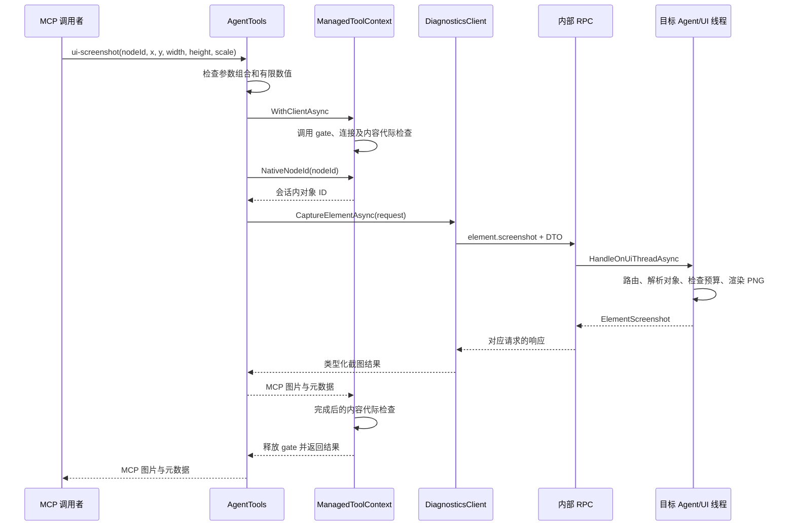

# 如何扩展工具

本文回答：新增一个能力从哪里入手、哪些层需要变化、哪些基础设施直接复用。
目录迁移、共享 `ManagedToolContext`、公共 Catalog、stdio/HTTP 宿主和 Agent 同步领域路由已经实现。
Protocol 的核心混合契约及 Client 的 Exploration/Inspection 薄代理也已拆到对应能力目录，公开 API 与 wire 常量保持。
`OfficialTools`、`AgentTools`、`InspectorTools` 仍是兼容聚合壳，其 partial 文件已经按领域组织；新功能可用普通工具类。
工具使用 MCP SDK 特性，类在 Catalog 显式注册；没有扫描整个程序集，也没有动态 DLL 插件系统。
默认 stdio 保留三个 profile；HTTP 首版仅提供 `agent` 的 44 项工具，复用同一目录与实现。

## 先判断扩展属于哪一种

| 想增加的能力 | 从哪里开始 | 通常涉及的层 | 不需要重复实现 |
| --- | --- | --- | --- |
| 组合已有查询、输入、等待 | CLI 的功能工具入口 | CLI、对应测试和文档 | Agent、RPC、对象注册表 |
| 读取或修改新的 Avalonia 目标状态 | Agent 的能力实现 | Protocol、Agent、Client、CLI、测试 | 管道、消息封装、UI 调度、连接握手 |
| 新 Windows UIA/OS 操作 | NativeAutomation facade 与 worker | native 契约、facade、worker、CLI、测试 | managed RPC、Avalonia 对象 ID |
| 支持另一 Avalonia 版本的内部诊断 | Agent 的版本相关适配代码 | adapter、依赖配置、相关运行验证 | MCP 工具名、稳定 DTO、传输协议 |

一个 MCP 工具不一定对应一个新 RPC；一个 RPC 也可以供多个工具或 C# 调用者复用。
跨层变化是跨进程能力的正常成本：契约负责传数据，Agent 负责执行，Client 负责类型化调用，CLI 负责对外表达。
需要治理的是共享策略散落、重复业务算法、依赖另一组工具的内部实现。

## 最少阅读顺序

第一次接手时，按下面顺序读一个小闭环，再选择其他能力，不必从所有项目逐个读起。

1. [项目入口与应用接入](../../README.md)：区分目标应用、MCP 进程、预览进程和 Windows worker。
2. [McpToolCatalog.cs](../../src/AvaloniaDevTool.Cli/Catalog/McpToolCatalog.cs) 与 [ManagedToolContext.cs](../../src/AvaloniaDevTool.Cli/Sessions/ManagedToolContext.cs)：了解工具注册、调用 gate 和节点身份。
3. [AgentTools.Screenshot.cs](../../src/AvaloniaDevTool.Cli/Tools/Rendering/AgentTools.Screenshot.cs)：看一个完整 MCP 入口。
4. [DiagnosticsClient.Screenshots.cs](../../src/AvaloniaDevTool.Client/Features/Rendering/DiagnosticsClient.Screenshots.cs) 与 [ExplorationContracts.cs](../../src/AvaloniaDevTool.Protocol/Contracts/Tree/ExplorationContracts.cs)：看请求/响应如何跨进程。
5. [AgentSession.Screenshot.cs](../../src/AvaloniaDevTool.Agent/Features/Rendering/AgentSession.Screenshot.cs)：看实际能力和失败边界。
6. [AgentScreenshotMcpTests.cs](../../tests/AvaloniaDevTool.Cli.Tests/AgentScreenshotMcpTests.cs)：看调用者如何证明行为。

需要理解入口选择和释放时，再读 [Program.cs](../../src/AvaloniaDevTool.Cli/Hosting/Program.cs)、[ToolSession.cs](../../src/AvaloniaDevTool.Cli/Sessions/ToolSession.cs) 和 [DiagnosticsAgent.cs](../../src/AvaloniaDevTool.Agent/Hosting/DiagnosticsAgent.cs)。
需要修改 framing、断流或超时时，再读 [RpcPeer.cs](../../src/AvaloniaDevTool.Protocol/Transport/RpcPeer.cs)，普通新增工具无需触碰它。

## 当前实现：ui-screenshot 的完整链路

调用者先通过当前连接的 `tree/search` 获得数值节点 ID，再调用 `ui-screenshot`。
此 ID 包含连接及预览内容代际，不能把 Agent 内部对象编号或 Windows native 字符串 ID 直接传入。
控件截图使用本地 DIP 和输出缩放；Windows 截图使用物理像素，二者不能混用。



| 步骤 | 实际源码 | 负责的事情 |
| --- | --- | --- |
| 入口 | [AgentTools.Screenshot.cs](../../src/AvaloniaDevTool.Cli/Tools/Rendering/AgentTools.Screenshot.cs) | 参数组合、公开 ID 转换、MCP 图片与文本输出 |
| 调用上下文 | [ManagedToolContext.cs](../../src/AvaloniaDevTool.Cli/Sessions/ManagedToolContext.cs) | 串行化 managed 调用、节点代际、连接一致性、错误转换 |
| Client | [DiagnosticsClient.Screenshots.cs](../../src/AvaloniaDevTool.Client/Features/Rendering/DiagnosticsClient.Screenshots.cs) | 将类型化请求交给 `InvokeAsync` |
| 契约 | [ExplorationContracts.cs](../../src/AvaloniaDevTool.Protocol/Contracts/Tree/ExplorationContracts.cs) | `element.screenshot`、`CaptureElementRequest`、`ElementScreenshot` |
| UI 调度 | [DiagnosticsAgent.cs](../../src/AvaloniaDevTool.Agent/Hosting/DiagnosticsAgent.cs) | 将请求执行移到目标 UI 线程 |
| 路由 | [AgentSession.Exploration.cs](../../src/AvaloniaDevTool.Agent/Features/Tree/AgentSession.Exploration.cs) | 反序列化截图请求并选择处理逻辑 |
| 实现 | [AgentSession.Screenshot.cs](../../src/AvaloniaDevTool.Agent/Features/Rendering/AgentSession.Screenshot.cs) | 可见性、局部边界、像素/字节预算、实际 PNG 渲染 |
| 序列化 | [ProtocolJsonContext.cs](../../src/AvaloniaDevTool.Protocol/Serialization/ProtocolJsonContext.cs) | 内置 wire DTO 的源生成元数据 |
| 验证 | [AgentScreenshotMcpTests.cs](../../tests/AvaloniaDevTool.Cli.Tests/AgentScreenshotMcpTests.cs) | 独立 stdio 调用、PNG 解码、实际像素和失败条件 |

`AgentTools` 直接复用 `ManagedToolContext`，不再经 `OfficialTools` 借用基础设施。
`NativeNodeId` 在这里指 Agent 内部对象编号；`PublicNodeId` 负责反向编码，二者都应在上下文 gate 内使用。
兼容入口 `screenshot` 复用底层渲染但只返回图片；`ui-screenshot` 还提供区域、缩放与元数据。

## 路线一：组合已有能力的 MCP 工具

典型例子是 [ui-wait](../../src/AvaloniaDevTool.Cli/Tools/Input/AgentTools.Wait.cs)。
它组合现有 Search/Props 查询，自己处理轮询、匹配和等待期限，没有新增 Agent RPC。
这是调用侧编排；若编排需要在目标 UI 线程中原子观察状态，才需要重新评估执行位置。

当前新增这类工具时：

1. 在 `Cli/Tools/<领域>` 增加普通工具类，声明 `[McpServerTool]` 和清楚的参数/行为说明；兼容维护可继续编辑既有 partial。
2. managed 操作复用 `ManagedToolContext.WithClientAsync`；在回调内调用 `NativeNodeId`，返回对象身份通过 `PublicNodeId/PublicNodes` 编码。
3. 为每次有界查询释放 gate，避免一个长等待独占全部 managed 操作；参考 `ui-wait`。
4. 在 CLI 测试中验证工具可发现、成功语义、超时/取消及切换目标后的行为。
5. 更新工具目录和对应说明，若目录测试固定了清单，应同步更新预期。

在 [McpToolCatalog.CreateTools](../../src/AvaloniaDevTool.Cli/Catalog/McpToolCatalog.cs) 的相应 profile 分支显式注册新类一次。
`ReadTools` 只读取已传入实例的公开 SDK 特性方法；不是扫描程序集中的所有工具类。
同一已注册类里增加方法会被发现，新增类则必须注册；普通扩展不修改 Program 或传输宿主。
当前默认目录边界由 [AgentInteractionBoundaryMcpTests.cs](../../tests/AvaloniaDevTool.Cli.Tests/AgentInteractionBoundaryMcpTests.cs) 验证。

## 路线二：新增目标内 RPC 能力

当现有 Client 没有所需操作，且必须访问目标 Avalonia 对象时，沿完整链路增加能力。
下表是职责位置，不表示每项都必须新建项目或接口。

| 修改位置 | 要完成什么 | 复用什么 |
| --- | --- | --- |
| Protocol/Contracts 对应领域 | 方法名、请求/响应、可解释的截断/失败状态 | 现有 envelope、JSON 命名规则 |
| Protocol/Serialization | 在 ProtocolJsonContext 注册新 wire 类型及实际集合形状 | 独立 [ProtocolJson](../../src/AvaloniaDevTool.Protocol/Serialization/ProtocolJson.cs) 源生成序列化入口 |
| Agent 功能实现 | 参数、对象类别、状态检查、算法和资源归属 | 同一弱对象注册表、会话通知、现有领域服务 |
| Agent 领域 Register*Methods | 用 Map<TRequest> 将方法映射到同步处理器 | 请求反序列化、统一 UI 调度与 RPC 错误处理 |
| DiagnosticsClient 功能文件 | 暴露类型化异步方法 | InvokeAsync、连接、请求关联和取消等待 |
| CLI 功能入口 | 参数表达、公开节点身份、MCP 内容格式 | 调用上下文、SDK 特性、schema 验证 |
| 对应测试 | 领域行为、传输边界或对外契约 | 已有 fixture、stdio 测试支撑 |

[AgentSession.Routing.cs](../../src/AvaloniaDevTool.Agent/Sessions/AgentSession.Routing.cs) 在构造阶段集中调用各领域 `Register*Methods`。
例如 [Input/AgentSession.Routes.cs](../../src/AvaloniaDevTool.Agent/Features/Input/AgentSession.Routes.cs) 已有如下注册语句：

```csharp
Map<ClickInputRequest>(InputMethods.Click, request => _input.Click(request));
```

新同步方法追加到所属领域的注册方法；新增领域时，再向 `RegisterSyncMethods` 加一次该领域注册调用。
`Map<TRequest>` 统一读取请求并加入会话路由表，重复方法名会在注册时失败。
[AgentSession.cs](../../src/AvaloniaDevTool.Agent/Sessions/AgentSession.cs) 负责查表；少数兼容操作仍走 `HandleExploration`，当前截图链属于此路径。
异步 Composition 仍由 [AgentSession.Async.cs](../../src/AvaloniaDevTool.Agent/Sessions/AgentSession.Async.cs) 协调，不能把需要等待的操作阻塞塞进同步 Map。
不要为了新增一个操作同时复制 `RpcPeer`、连接锁、超时或自己的 UI Dispatcher 包装。
普通方法只需通过既有调用链进入 UI 线程；需要 render-thread 工作的能力参考 Composition 的既有边界。
有订阅、临时修改、流或缓存的能力，必须接入会话结束后的释放，而不是只处理成功路径。
Client 若同时服务独立 C# 消费者，仍应保留；不能把 MCP 格式类型渗入目标 Agent。

## 路线三：新增 Windows native 能力

native 能力在独立 worker 执行，不经过目标 Agent 的 managed RPC。
入口参考 [AgentTools.NativeScreenshot.cs](../../src/AvaloniaDevTool.Cli/Tools/Native/AgentTools.NativeScreenshot.cs)，执行参考 [NativeAutomationBackend.Screenshot.cs](../../src/AvaloniaDevTool.NativeAutomation.Worker/Capture/NativeAutomationBackend.Screenshot.cs)。

1. 在 [NativeAutomationContracts.cs](../../src/AvaloniaDevTool.NativeAutomation/Contracts/NativeAutomationContracts.cs) 或对应功能契约定义请求/响应。
2. 在 [NativeAutomationSession.cs](../../src/AvaloniaDevTool.NativeAutomation/Sessions/NativeAutomationSession.cs) 增加类型化 facade 方法，复用 worker 请求 gate 和期限。
3. 在 [NativeAutomationBackend.cs](../../src/AvaloniaDevTool.NativeAutomation.Worker/Sessions/NativeAutomationBackend.cs) 的 Dispatch 注册 worker 命令，将具体实现归入功能文件。
4. 复用目标 PID+启动时间、窗口 owner、UIA runtime ID 和生命周期验证；只能操作已附加目标的允许范围。
5. 维护现有 AgentTools partial 时复用 `WithNativeAsync`；CLI 内的普通类可使用同一 `ToolSession.GetNativeSessionAsync`，并保留现有错误映射和归属检查。
6. 在 native 测试验证底层行为，再按风险增加真实 stdio/模态交互测试。

[NativeWorkerProtocol.cs](../../src/AvaloniaDevTool.NativeAutomation/Worker/NativeWorkerProtocol.cs) 是 facade/worker 的独立消息合同。
不要把 native DTO 加到 managed `ProtocolJsonContext` 来假装完成 worker 序列化支持。
当前 worker 使用自己的 JSON 选项和反射序列化；它的 AOT 支持不能由 Agent/Protocol 的 AOT 结果推导。
managed 与 native 的 gate 必须分开，才能在 managed 点击等待模态弹窗时继续处理系统窗口。
native 返回 pending/dispatched/injected 表示动作阶段，业务效果仍应通过后续状态观察验证。
文件弹窗流程复用 [NativeFileDialogController](../../src/AvaloniaDevTool.NativeAutomation/FileDialogs/NativeFileDialogController.cs)，不另写一套 picker 状态机。
像素几何单测不能替代真实窗口截图验证；参考 [NativeScreenshotIntegrationTests.cs](../../tests/AvaloniaDevTool.NativeAutomation.Tests/NativeScreenshotIntegrationTests.cs)。

## 路线四：新增框架版本适配

当前 [Directory.Build.props](../../Directory.Build.props) 固定 Avalonia 12.1.4，源码没有可任意切换版本的通用 adapter 注册中心。
[Avalonia12DiagnosticsAdapter.cs](../../src/AvaloniaDevTool.Agent/Framework/Avalonia12/Avalonia12DiagnosticsAdapter.cs) 集中一部分样式/绑定 PrivateApi 访问。
[Avalonia12CompositionAdapter.cs](../../src/AvaloniaDevTool.Agent/Framework/Avalonia12/Avalonia12CompositionAdapter.cs) 则处理 compositor 内部结构与渲染线程工作。
这些版本边界是实际替换点；普通公共 API 操作无需为每个版本重复建一套工具。

新增版本支持时：

1. 明确是整体升级当前依赖，还是要同时支持两个目标版本；后者的打包/加载策略需要单独设计。
2. 检查 adapter 及其他版本相关 API，不能只修改包版本或放宽版本判断。
3. 保持稳定的领域 DTO；只有真实能力或数据语义改变才扩展协议与 MCP 契约。
4. 对不支持的内部结构返回明确 unsupported/limitations，不伪造完整诊断数据。
5. 用对应版本的真实目标验证样式、绑定、渲染及资源释放，必要时覆盖预览和 trimming/AOT。

未来若确有同时支持多版本的需求，再引入适配接口及选择策略；不为单个当前实现先造通用插件平台。
已有版本判断不构成任意补丁版本兼容证明，兼容范围应与运行证据对应。

## 普通工具类示例：读取附加应用信息

下面是可放入 `Cli/Tools/Connection/AppInfoTools.cs` 的示例，使用当前已有 API。
`AppInfoTools` 和 `app-info` 尚未加入源码或 Catalog；它们不是现有 44 项工具之一。

```csharp
using System.ComponentModel;
using AvaloniaDevTool.Protocol;
using ModelContextProtocol.Server;

namespace AvaloniaDevTool.Cli;

[McpServerToolType]
public sealed class AppInfoTools(ManagedToolContext context)
{
    [McpServerTool(Name = "app-info", ReadOnly = true, Destructive = false)]
    [Description("Reads the attached application's session information.")]
    public Task<SessionInfo> GetInfo(CancellationToken cancellationToken = default) =>
        context.WithClientAsync(cancellationToken, (client, _) =>
            Task.FromResult(client.Session ??
                throw new RpcException("not_connected", "Attach to an application first.")));
}
```

注册时，在 `McpToolCatalog.CreateTools` 的 `agent` 分支向已有工具集合追加一次：

```csharp
tools.Concat(ReadTools(new AgentTools(session, context)))
    .Concat(ReadTools(new AppInfoTools(context))).ToArray();
```

这只是该分支的结果表达式；保留原有 profile 分支、兼容声明和过滤器。
声明的工具名必须唯一；不要复制另一个类并继续使用 `ui-screenshot` 等已有名字。
节点型工具在 `WithClientAsync` 回调中调用 `context.NativeNodeId(nodeId)`，返回内部节点需调用 `context.PublicNodeId` 或集合映射方法。
上下文已经负责调用前后身份检查、managed gate 和错误转换；工具不能缓存一次解码后永远有效的内部 ID。
继续使用 SDK 特性和 Description；不要求通用 `ITool`、自定义 schema 或每类必配一个接口。

## 同一扩展如何进入 stdio 与 HTTP

[StdioMcpHost](../../src/AvaloniaDevTool.Cli/Hosting/Stdio/StdioMcpHost.cs) 为当前进程建立 ToolSession，并调用 Catalog 的 `Register`。
[HttpMcpHost](../../src/AvaloniaDevTool.Cli/Hosting/Http/HttpMcpHost.cs) 为每个 MCP 协议会话创建独立 ToolSession/ManagedToolContext。
HTTP 依次调用 `CreateTools(state.Session, profile, state.Context)` 和 `Configure(options, tools, profile)`，复用工具声明、输入校验和输出过滤。
HTTP 请求不是会话所有者；不能每次请求新建或释放 ToolSession，也不能让不同客户端共享工具实例。
因此，新增 `agent` 工具只需在 Catalog 注册一次，两种传输都能使用；无需向 HTTP 宿主重复写业务路由。
HTTP 当前只接受 `agent`，`official/extended` 继续仅在 stdio 使用；新增能力须明确属于哪个目录并同步目录测试。
HTTP 的节点代际由宿主分配器跨协议会话分配，工具应复用传入上下文，不自行构造第二份上下文。

## 按行为风险选择检查

| 变化 | 应检查的关键点 | 通常直接复用 |
| --- | --- | --- |
| 纯查询/编排 | 查询边界、唯一性、截断、轮询期限和目标切换 | 当前会话和调用上下文 |
| 状态修改 | 参数先验证、失败不部分写入、覆盖可恢复、应用后续写入冲突 | 现有可逆覆盖/资源编辑服务 |
| 订阅/采集 | stop/detach/失败释放，缓冲与历史预算，丢失状态 | 同连接采集归属、mutation epoch、已有 listeners |
| 新 wire DTO | 实际集合形状、源生成注册、JIT/AOT 序列化 | ProtocolJson 与源生成入口 |
| 原生操作 | 身份过期、owner 范围、模态、期限后的 worker 回收 | native 会话、节点验证与独立 gate |
| 图像/大数据 | 像素、编码字节、响应大小和完整性 | 截图预算、分块导出、RPC framing |
| 框架内部 API | 版本与结构不匹配、limitations、线程亲和性 | 版本 adapter 和能力专项 fixture |

取消通常结束等待，不能承诺中止已在 UI 线程执行的同步 getter 或应用处理器。
新增操作应传播 CancellationToken，并明确取消后的资源归属；无需为每个工具重写请求关联机制。
内部 managed RPC 帧有 4 MiB 预算，图片 Base64 与 envelope 都占空间；不能只按原始 PNG 大小推算响应。
新增 DTO 的序列化检查应使用 [ProtocolJsonAotTests.cs](../../tests/AvaloniaDevTool.Protocol.Tests/ProtocolJsonAotTests.cs) 等现有入口；普通 MCP 编排不必触发完整 AOT 发布。
验证范围随变化选择：只改文档不运行应用；新增目标状态操作应验证真实状态，native/UI 风险则补对应运行场景。

## 已落地结构与兼容边界

| 原有组织方式 | 当前实现 | 继续保持的行为 |
| --- | --- | --- |
| `AgentTools` 经 `OfficialTools` 借用上下文 | 二者平级复用 `ManagedToolContext`，旧构造器作薄兼容适配 | 连接代际、内容代际、调用 gate |
| 源文件大多平铺 | 全部生产项目已按目录归位，旧工具 partial 位于 Tools 对应领域 | namespace、程序集、API 与独有语义 |
| 核心 Contracts.cs 混合 DTO/JSON/异常 | Session/Tree/Properties/Selection 契约、Serialization 和 Transport 已拆开 | 原公开类名、方法名和 wire 常量 |
| Client Exploration/Inspection 混合薄代理 | Tree、Rendering、Styles、Resources、Assets、Activity 等独立文件 | 原方法/事件与请求正文 |
| AgentSession 大 switch | 同步领域 Register*Methods/Map 路由表，保留少数兼容 fallback 与异步路径 | 同一对象身份、UI 调度、释放责任 |
| Program 混合注册与宿主启动 | Hosting 选择传输，Catalog 组合工具与契约 | stdio 三目录及 HTTP agent 范围 |

保留聚合壳不妨碍新工具使用普通类；删除兼容入口、重命名公开类型或修改 wire 参数仍须独立评估。
`Official*` 命名的测试可能验证深树、XAML、绑定恢复等通用行为，应按功能迁移，不能按前缀删除。
`extended` 的 metrics/profiler/activity 服务也被默认 capture 工具复用；移除目录分类不等于删除底层服务。
一个扩展完成后，应能指出：入口、领域实现、契约、可观察结果、必要验证及实际限制。
截图的现有专项已经涵盖像素、局部区域、缩放、过期节点、隐藏/脱离控件及预算；复用这些测试支撑，不重复制造一套宿主。
HTTP 扩展参考 [HttpMcpIntegrationTests.cs](../../tests/AvaloniaDevTool.Cli.Tests/HttpMcpIntegrationTests.cs) 的目录/状态隔离、[HttpSessionLifetimeTests.cs](../../tests/AvaloniaDevTool.Cli.Tests/HttpSessionLifetimeTests.cs) 的租约与释放，以及 [HttpNativeMcpTests.cs](../../tests/AvaloniaDevTool.Cli.Tests/HttpNativeMcpTests.cs) 的模态与真实文件往返。
[Test-McpHttp.py](../../tests/scripts/Test-McpHttp.py) 使用标准库从独立客户端访问 `/mcp`；调用时传真实 `--url` 和专用 AutomationSample 的 `--pipe`，Windows 原生枚举可加 `--native-windows`。
完整构建、专项结果和真实桌面限制以 [测试说明](../testing.md) 为准；上述链接是扩展验证入口，不自动证明新增工具已经通过。
