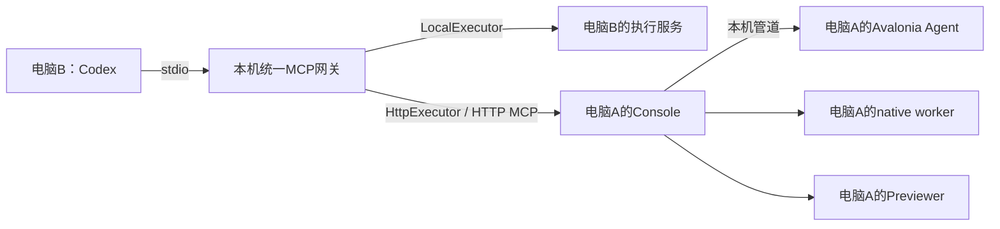

# 本机与远端执行

用户只配置一个本机stdio MCP。远端电脑运行Console，网关根据select-machine选择LocalExecutor或HttpExecutor，默认端口7443。外部脚本可直接作为HTTP MCP客户端使用Console；Codex日常使用统一stdio网关。



## A端启动

```cmd
AvaloniaDevTool.exe serve
```

默认监听IPv4接口的7443端口和/mcp路径。需要限制网卡可传--listen；维护时可传--port。当前无Token内网模式。Console、目标应用和worker处于同一已登录用户交互桌面，普通Windows后台Service不是当前部署形态。

A端先运行Console，再运行引用Agent SDK的应用（顺序可互换）。应用必须在框架初始化完成后Attach；A不需要安装Codex。B通过URL不能在A创建Console进程。

## B端操作

B的MCP配置使用安装后稳定exe和args=["mcp"]。调用select-machine指定A的IP，然后发现并附加A的应用。用户工具不需要配置HTTP传输或端口。

图像内容通过HTTP返回网关，再通过stdio返回Codex。路径、文件弹窗、项目构建和预览都发生在A；B路径不自动共享。

## 单机开发验证

同一台电脑可以同时运行被测应用与serve。网关先走LocalExecutor完成一轮，再选择127.0.0.1通过HttpExecutor重复一轮。显式回环IP不能优化回LocalExecutor。

切换后重新发现与附加，不复用上一会话节点。测试顺序运行，避免同一个目标Agent的单连接和执行桌面控制租约竞争。该测试覆盖HTTP、会话、图片、原生/预览执行链和网关转换；独立网络、防火墙和交互桌面差异仍须另行现场验证。

## 会话与故障

候选端初始化与能力核验不附加目标。存在在途调用或未结束native动作时拒绝切换，保留原机并允许继续处理模态。成功切换退休旧句柄；失联不自动回本机，可能已经执行的动作不重试。

HTTP执行端按逻辑MCP会话持有目标和自建资源，原有闲置回收与单控制者规则保留。外部脚本也可作为MCP客户端连接，但不能把另一个会话的句柄直接带过来使用。

完整分发、安装与运行时前置见[打包与安装](../packaging-and-installation.md)，CLI参数与兼容入口见[MCP](../mcp.md)。
