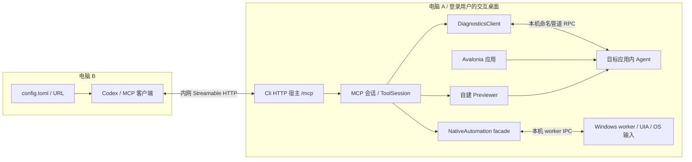

# 双机内网 MCP 部署

状态：**已实现并通过本机、真实 Codex 与 WSL 跨系统专项。** 当前 CLI 同时提供 stdio 和无 Token 的内网 HTTP MCP。独立两台物理电脑的 LAN 仍需现场验证；WSL 非回环路径的一项正文读取超时保留为实际限制。验证范围见[测试说明](../testing.md)。

主场景已经确定：Codex 在电脑 B，Avalonia 应用及完整执行端在电脑 A，两机经内网访问，首版不使用 Token。
A 提供 Streamable HTTP MCP 入口，B 直接配置 A 的 URL；保留现有本机 stdio 用法。
首版 HTTP 提供默认 `agent` profile 的 44 项完整自动化工具；stdio 继续支持现有三个 profile。
结构调整衔接[项目重构蓝图](refactoring-blueprint.md)，现行行为参照[MCP 说明](../mcp.md)。

## 1. 选定的部署与执行关系



- A 负责工具执行、应用发现、UI 调度、预览构建、文件访问及原生自动化。
- B 负责发 MCP 请求、接收结果和组织业务步骤；不额外运行 stdio-to-HTTP bridge。
- `DiagnosticsClient → Agent` 继续使用 A 上的命名管道；无需把内部 RPC 改成网络协议。
- native/file-dialog、预览及 capture 都在 A；A 的 CLI、目标应用与 worker 处于同一可交互用户桌面。
- `attach-to-app` 发现 A 的应用；`attach-to-file`、保存/打开路径都指 A 的文件系统。
- B 的本地路径不会自动映射到 A；截图和资产通过既有 MCP 结果内容返回 B。

### CLI 怎样关联正在运行的应用

URL 选电脑，应用 id 选进程，nodeId 选控件。Codex 按配置连接 MCP 服务后，`attach-to-app` 只是选择服务管理的目标程序，不是再次手动建立网络连接。

应用需要引用 `AvaloniaDevTool.Agent`，在 Avalonia 初始化完成后执行并保存实例，退出时释放：

```csharp
// Run on the Avalonia UI thread and retain the instance until application shutdown.
_diagnostics = DiagnosticsAgent.Attach(this, new DiagnosticsAgentOptions
{
    ApplicationName = "MyApp"
});
```

默认管道名为 `avalonia-devtool-{进程ID}`。A 上的 CLI 枚举本机诊断管道，返回当前 MCP 会话的应用 id，再按选中的管道建立连接并读取 `session.info`，验证协议版本并取得真实应用名/PID。

```text
attach-to-app {}                 discover A's endpoints
attach-to-app {"id": <returned>} attach the selected endpoint
tree {}                         read the attached application's controls
```

应用 id 不是 PID，必须使用本次列表返回值；多实例通过不同管道和进程区分。首次发现只列候选端点，未握手时名称可能仍为管道名，发现也不代表连接已成功。

固定调试目标可在应用和 A 的 CLI 两边约定相同 `--pipe`，首次需要目标的工具会懒附加；否则由 Codex 根据发现结果附加。默认不擅自选择第一个应用。完全自定义且不以 `avalonia-devtool-` 开头的管道，需在 A 的 CLI 用 `--pipe` 明确配置。

源码入口：[SDK 接入](../../src/AvaloniaDevTool.Agent/Hosting/DiagnosticsAgent.cs)、[默认选项](../../src/AvaloniaDevTool.Agent/Hosting/DiagnosticsAgentOptions.cs)、[发现](../../src/AvaloniaDevTool.Cli/Connections/ToolSession.Discovery.cs)、[应用附加工具](../../src/AvaloniaDevTool.Cli/Tools/Connection/OfficialTools.Connection.cs)。

## 2. 三层配置各自负责什么

| 层 | 配置位置与例子 | 作用 |
| --- | --- | --- |
| MCP 连接配置 | B：`url = "http://192.168.1.50:7443/mcp"` | 让 Codex 连接 A 的 MCP 服务 |
| 服务端进程参数 | A：`mcp --transport http --listen 192.168.1.50 --port 7443` | 指定 A 的监听传输、网卡地址和端口 |
| 工具业务参数 | `attach-to-app` 的 id、`tree` 的 nodeId、文件路径 | 在当前服务上选择并操作业务目标 |

**URL 的 IP 可以配置。** A 用 `--listen` 指定绑定 IP，B 在 MCP 的 `url` 中填写能访问 A 的地址。
IP 不加进每个工具参数；一次连接确定服务端，随后 `tools/call` 沿用这个服务端。
`--pipe` 仍指 A 的本机 Agent 管道，与 B 到 A 的 URL 是两段独立连接。

## 3. A 的命令行接口

以下选项已由 CLI 参数模型实现。以 A 的完整 CLI 分发目录为工作目录启动；示例 IP 替换为 A 的实际可达地址：

```powershell
dotnet AvaloniaDevTool.Cli.dll mcp --transport http --listen 192.168.1.50 --port 7443
```

可继续使用现有 `--pipe` 指定初次操作时附加的本机目标：

```powershell
dotnet AvaloniaDevTool.Cli.dll mcp --transport http --listen 192.168.1.50 --port 7443 --pipe avalonia-devtool-demo
```

### 被测电脑上的 CLI 由谁启动

A 上的 CLI 是本地常驻执行宿主。B 的 Codex 从标准 MCP 配置读取 URL 并连接它，不会通过这个 URL 在 A 上创建进程；A 不需要安装 Codex。

首次部署流程：

1. 将完整 CLI 分发目录放在 A，保留相邻的 `previewer/`、`native-worker/` 及运行依赖；不能只复制一个 DLL。
2. 在 A 已登录的目标用户桌面中，从分发目录执行上述命令，IP 替换成 A 的实际内网地址。
3. 运行接入 Agent SDK 的 Avalonia 应用。CLI 可以先于应用启动；发现/附加工具执行时目标应用须已就绪。
4. B 的 Codex 按自己的 MCP URL 配置加载连接，随后通过工具发现和附加 A 的应用。

手动调试时保持 A 的控制台进程运行，用 Ctrl+C 正常退出并清理自建资源。日常部署可在 A 的任务计划中配置“仅当该用户登录时运行”，由登录事件启动同一命令。自动启动仍是 A 本地的部署配置，不在 B 的 MCP 条目里增加远程进程启动参数。

首版不把完整执行宿主注册成 Windows Service；UIA/OS 输入需要目标用户的交互桌面。任务计划的工作目录设为 CLI 分发目录，进程启动不依赖 B 的工作目录。

| 参数 | 默认值 | 设计规则 |
| --- | --- | --- |
| `--transport stdio\|http` | `stdio` | 每项一次；省略时保持现行 stdio 行为 |
| `--listen IP` | HTTP 下 `127.0.0.1` | 仅 HTTP 有效；内网访问须显式传入绑定地址 |
| `--port PORT` | HTTP 下 `7443` | 仅 HTTP 有效；端口范围 1..65535 |
| `--pipe NAME` | 现行语义 | 两种传输共用；每项一次且非空 |
| `--profile agent\|official\|extended` | `agent` | stdio 保留三个值；HTTP 首版仅允许 `agent`，其他已知值启动前报 `unsupported_profile` |

地址与端口校验在创建宿主、监听和附加应用之前完成：

1. 接受完整 IPv4 点分十进制或合法 IPv6 字面量；IPv4 必须四段、每段 0..255。
2. 拒绝主机名、完整 URL、附带端口的地址、空白、IPv4 简写/整数表示及首版不支持的 IPv6 scope ID。
3. IPv6 参数传纯地址，不加 URL 方括号；生成访问 URL 时按 IPv6 URL 规则加方括号。
4. 端口为十进制整数；拒绝负数、符号、空白、零、超范围与非数字值。
5. 重复项、未知项、缺值、空值均报参数错误；显式或默认 stdio 下出现 `--listen/--port` 也拒绝。
6. 参数顺序不影响结果；解析完全部选项后再检查传输相关组合。
7. HTTP 下显式 `--profile official` 或 `--profile extended` 返回 `unsupported_profile`；未知 profile 仍为参数错误，均不开始监听。

`0.0.0.0` 可以作为 A 的通配绑定地址，表示监听全部 IPv4 接口；它不能用作 B 的连接 URL。
IPv6 通配地址遵循同一原则。启动日志同时显示绑定地址和固定路径；通配绑定时提示填写 A 的实际可达 IP。
`7443` 在本设计中是普通 HTTP 端口，端口号本身不表示 HTTPS。

原有启动保持有效：

```powershell
dotnet AvaloniaDevTool.Cli.dll mcp
dotnet AvaloniaDevTool.Cli.dll mcp --pipe avalonia-devtool-demo
```

stdio 标准输出继续只承载协议，诊断日志写标准错误。HTTP 日志也不与协议结果混写。

## 4. B 的 Codex 连接配置

Codex 直接配置 Streamable HTTP URL；本项目已提供 `/mcp` 服务端。
B 的唯一连接配置入口是 Codex 标准 `config.toml`，与其他 MCP 一样配置：

```toml
[mcp_servers.avalonia_testpc]
url = "http://192.168.1.50:7443/mcp"
```

Codex 按配置加载并连接已经运行的 A 服务；HTTP 连接只配置 `url`，不设置 `command`、`args`、Token 或登录步骤。
A 的 HTTP 宿主由 A 启动和管理，B 的连接配置不远程启动 A 的进程。
如果 A 的 IP 或端口改变，修改 B 的 URL 后重新连接，不修改工具 schema。

Codex 的 `url` 与匿名 HTTP 连接能力见[OpenAI 官方 MCP 文档](https://learn.chatgpt.com/docs/extend/mcp#streamable-http-servers)。
此处是本地 Codex 主机 B 访问内网服务的部署，不扩展为云端执行器可达性的承诺。

## 5. 新 HTTP 入口与现有 Remote 的边界

| 项目 | 新 Cli HTTP MCP | 现有 AvaloniaDevTool.Remote |
| --- | --- | --- |
| 对外路径 | 固定 `/mcp` | `/diagnostics` |
| 协议 | 标准 Streamable HTTP MCP | 项目内部 RPC 的 WebSocket 传输 |
| 消费方 | Codex 等 MCP 客户端 | DiagnosticsClient 的可选 remote 连接 |
| 执行范围 | A 的 managed/native/preview/capture | 保留当前 Remote 范围 |
| 首版认证 | 按用户要求无 Token、无 OAuth | 现有 Bearer/TLS/Origin 规则保持 |

本设计为 Cli 增加外层 MCP 网络入口，不通过修改 Remote 来取消其认证或 TLS 条件。
`/diagnostics` 不能填进上述 Codex URL，内部命名管道也不是 MCP URL。
当前不要求证书、OAuth 或 `--allow-insecure` 启用门槛；绑定地址显式表达是否允许内网接入。
无 Token 模式下 MCP session ID 仅用于协议关联，不代表用户身份，也不提供用户权限隔离。

## 6. 有状态 MCP 会话与控制权

首版采用**有状态 Streamable HTTP**。一个协议会话拥有一个 ToolSession、工具实例和 managed 节点映射上下文。
HTTP 请求作用域只拥有当前请求，不能代替 MCP 会话作用域；不复用当前 stdio 的宿主级单例给所有网络客户端。
服务端会话 ID 的生成、传输和协议校验优先使用 MCP SDK；应用层补充目标控制租约与释放协调。

**SDK 兼容是运行条件。** 2.3.0 默认 `Stateless`；首版显式 `HttpServerSessionMode.Stateful`。
`2026-07-28` 及后续协议会收到 `-32022` 促降级；`StatefulForInitializeClients` 对新协议仍无会话，不能代替持久关联。
依据见固定版本的[HTTP 选项源码](https://github.com/modelcontextprotocol/csharp-sdk/blob/9a327829ef066c44a0d737c58bf3c7617d7c701c/src/ModelContextProtocol.AspNetCore/HttpServerTransportOptions.cs#L56-L88)及[会话模式源码](https://github.com/modelcontextprotocol/csharp-sdk/blob/9a327829ef066c44a0d737c58bf3c7617d7c701c/src/ModelContextProtocol.AspNetCore/HttpServerSessionMode.cs#L7-L59)。
本机 Codex CLI 0.164.0 已通过隔离配置的生产宿主工具发现，使用 initialize 并保持同一 Session ID；未触发模型调用。升级客户端或协议后仍需验证兼容性，不能按请求创建 ToolSession 或用跨客户端共享实例兜底。

一个 HTTP 宿主同时最多有一个活动目标控制者：

| 行为 | 控制规则 |
| --- | --- |
| initialize、tools/list | 建立或读取协议会话；不附加目标应用，不抢占其他会话 |
| 应用发现 | 允许当前会话建立自己的发现映射，沿用现行发现行为 |
| 首次 attach 或 `--pipe` 自动附加 | 原子取得宿主控制租约，再连接 A 的 Agent |
| 其他会话申请控制 | 返回明确 busy 错误；不抢断原连接、不替原会话 detach |
| 当前会话切换应用/文件预览 | 沿用现有切换与清理顺序，更新目标和节点代际 |
| `detach` 工具 | 释放目标、临时状态及控制租约；协议会话可继续发现并重新附加 |
| MCP 会话显式关闭 | 进入会话清理，最终释放 ToolSession 和控制租约 |

租约由宿主的控制协调器拥有，会话只持有自己的租约句柄；释放要核对所有者，不能清掉新会话的租约。
控制者以协议会话关联，不用来源 IP 识别；同 IP 的不同客户端也不共享 ToolSession。
控制协调不作为每次工具调用的全局串行锁；managed、native 和文件动作继续保留各自执行 gate。
首次附加尚无旧目标时，连接/预览启动失败或取消必须清理候选资源并立即归还临时租约，不能等闲置超时。
已有控制目标的切换失败继续遵循当前切换合同，单独核对旧目标是否已断开；不以首次附加回滚规则覆盖它。

## 7. 断线、闲置、重连与清理

单次 HTTP 响应结束、SSE 流断开或 TCP 重建，均不立即 detach，也不按请求结束释放 ToolSession。
只在显式会话关闭、闲置租约超时或宿主退出时结束协议会话；显式 `detach` 只结束目标附加。
对 SDK 支持的会话终止请求进行统一清理，不自造额外业务工具冒充协议关闭。

当前会话闲置租约为 10 分钟，作为宿主内部策略，通过可替换时间源测试：

- 有效 MCP 请求刷新最后活动时间；无效/过期 session ID 不续租。
- 活跃工具调用及其清理仍持有执行引用，不能被闲置回收误杀；长调用按原有操作期限处理。
- 空闲 GET/SSE keepalive 不永久续租；控制权不能只因网络流一直存在而无限保留。
- 超时结束等待后，已进入 UI 线程的同步代码可能仍执行；清理须等待实际拥有的操作安全退出。
- 关闭/超时后拒绝新调用，按既有释放顺序断开 Agent、回收自建预览/worker、处理 capture 所有权。
- 清理完成前不交出控制权；外部 Avalonia 应用不归 MCP 宿主所有，不因会话结束被终止。

上述应用租约不等同于 SDK 的 IdleTimeout；SDK 默认可由开放 GET 保活，需显式协调应用租约到期后的资源清理与协议会话终止。

网络恢复时区分两种情况：

| 恢复形式 | 处理 |
| --- | --- |
| 同一仍有效 MCP session 的 HTTP 连接重建 | 保留 ToolSession；目标连接/内容未变时继续当前会话 |
| 新 initialize、旧 session 已关闭/超时或客户端切换 | 建立新会话并重新争取控制；重新附加、读取 tree/search |

新会话不得沿用旧节点。`ManagedToolContext` 使用宿主共享的 `NodeGenerationAllocator`，在宿主运行期内分配不复用的节点连接代际；保留现有数值编码范围和耗尽策略，拒绝跨会话旧 ID 碰巧命中新对象。
宿主重启后客户端必须丢弃全部旧 ID 并重新附加、枚举；有限数值 ID 不承诺跨宿主进程的永久唯一，不引入代际持久化。
native ID、capture ID 和预览内容代际继续按各自所有权校验，不用 MCP session ID 替代这些身份。

首版 HTTP 的 `agent` 入口覆盖 canonical/ui、native/file-dialog 与 capture；共用现有 `agent` 工具名、schema 和业务实现。
stdio 的 `official/extended` 契约保持现状。后续按领域整理工具后再扩展 HTTP 目录；本次只确定新入口的首版范围，已有功能继续保留。

点击、输入、保存、accept、覆盖确认等写操作在断线后不盲目重试。
如果服务端可能已执行但响应丢失，调用方先读取应用/弹窗/文件状态，再决定后续动作。
首版不承诺跨网络断开的 exactly-once 执行，也不以请求 ID 重放实现业务幂等。

## 8. 当前代码位置与职责

```text
AvaloniaDevTool.Cli/
  Hosting/
    Options/McpHostOptions        独立参数模型与严格组合校验
    Stdio/StdioMcpHost             现有 stdio 启动路径
    Http/HttpMcpHost               ASP.NET Core /mcp，内部 HttpSessionRegistry 关联 SDK 会话
  Catalog/McpToolCatalog            HTTP 复用 agent 注册/schema；保留 stdio 三种 profile
  Sessions/
    HttpToolSession                工具状态、活跃调用、闲置期限与幂等关闭
    DesktopControlLease            每宿主单控制者的租约协调
    NodeGenerationAllocator        跨 MCP 会话不复用的 managed 节点代际
    ManagedToolContext             既有调用门、节点转换与代际校验
    ToolSession                    附加目标及 preview/native/capture 所有者
```

| 当前位置 | 当前职责 |
| --- | --- |
| [Program.cs](../../src/AvaloniaDevTool.Cli/Hosting/Program.cs) | 拆出参数解析、公共 Catalog、stdio/HTTP 两个组合入口；保留默认 stdio |
| [Cli.csproj](../../src/AvaloniaDevTool.Cli/AvaloniaDevTool.Cli.csproj) | 引入兼容当前 MCP SDK 的 HTTP 宿主依赖；保留 previewer/worker 分发，不新建 bridge 项目 |
| [OfficialTools.cs](../../src/AvaloniaDevTool.Cli/Tools/OfficialTools.cs)、AgentTools/InspectorTools | 按 MCP 会话构造，不跨客户端共享工具状态；提取共享 managed 上下文 |
| ToolSession 各 partial | 受 MCP 会话拥有；维持附加、native gate、capture epoch 和自建进程清理 |
| Agent、Client、Protocol | 保持 A 内部执行链和 RPC，新增 HTTP 层不改变 UI 调度、DTO 或预算 |
| Previewer、NativeAutomation、Worker | 继续在 A 启动及回收；保持原生范围校验和执行隔离 |
| Remote、Logging | 保持现有可选扩展与配置语义 |

HTTP 宿主使用固定 MCP SDK 2.3.0，已按真实会话回调接入 ToolSession；ASP.NET request scoped 不作为 MCP session scoped。RunSessionHandler 的实验性诊断只在该赋值处局部抑制，关闭逻辑仍由自有会话组件负责。
Cli 引入 ASP.NET Core 框架依赖后，framework-dependent 分发需要 A 安装匹配的 ASP.NET Core Runtime，stdio 启动也受该分发依赖约束。
自包含分发则随 Cli 宿主携带相应运行时；这项依赖留在 Cli，核心 Agent 不因此引入 ASP.NET Core。
Windows worker 需要 Windows Desktop Runtime。只附加已运行应用可使用对应运行时；attach-to-file 评估真实 MSBuild 项目及可选构建需要 A 安装 .NET 10 SDK，build=false 也仍需项目评估。

当前宿主最多保留64个活动 MCP 会话，HTTP 请求正文上限8 MiB；领域原有像素、字节、历史和 RPC 帧预算继续独立生效。

## 9. 错误边界与日志

| 边界 | 预期结果 |
| --- | --- |
| 非法参数或组合 | 启动前失败，保留参数错误退出码 2，错误写标准错误 |
| HTTP 选择 official/extended | 启动前返回 `unsupported_profile`，退出码 2，不监听、不改变 stdio 支持范围 |
| 非本机绑定地址、端口已占用、监听失败 | 宿主启动失败并说明 listen/port；不降级到其他接口或随机端口 |
| A 未启动/网络不可达 | B 报连接问题；不伪装为找不到 Avalonia 节点 |
| 非 `/mcp` 路径、非法 HTTP/MCP 消息 | 由 HTTP/MCP SDK 按协议拒绝，不进入业务 handler |
| 缺失/未知/过期会话关联 | SDK 协议错误或会话已失效结果；不隐式创建目标会话 |
| 宿主控制权被其他会话占有 | 新增明确 `controller_busy` 业务错误；现有 Agent `session_busy` 仍保留 |
| Agent 断开、旧节点、capture/native 过期 | 保留现有错误与恢复指引；不因 HTTP 包装抹平领域错误 |
| 请求取消/响应写入失败 | 停止当前等待；保留会话直至规定关闭条件，记录结果是否可能已执行 |
| 会话清理/宿主退出 | 拒绝新调用，释放自身资源；不声称已强制终止目标 UI 的同步处理 |

日志区分 MCP session、当前目标、请求和执行阶段；不把 session ID 描述成认证身份。
输入文本与文件内容不默认整段写入日志；启动日志不能把 `0.0.0.0` 展示成 B 应使用的访问地址。

## 10. 验证范围与部署验收

下表是部署验收清单。已执行的本机 HTTP、真实 Windows 模态/文件闭环、Codex 和 WSL 专项见[测试说明](../testing.md)；不得把它们自动等同于独立物理双机验收：

| 验收场景 | 预期证据 |
| --- | --- |
| stdio 三 profile 回归及非法参数 | 原 `mcp`、pipe、agent/official/extended 有效；HTTP-only 参数在 stdio 拒绝，重复项/IP/端口错误启动前失败 |
| HTTP profile 范围 | 默认/显式 agent 有效；official/extended 启动前报 `unsupported_profile`，不产生监听或目标附加 |
| HTTP 默认与 LAN 显式绑定 | 默认只回环；A 显式 IP 后 B 可连 `/mcp`；绑定失败不静默换地址 |
| B 的 Codex initialize/tools/list | Codex 按 config.toml 的 URL 加载连接，无手工连接命令/Token/登录；44 项 agent 工具名/schema 与 stdio agent 对齐 |
| SDK 协议协商与会话关联 | 实际 Codex 能协商/降级并跨请求保持同一 ToolSession；无有效关联时阻止实施，补独立控制会话设计 |
| A 应用发现/附加/树/属性 | 返回 A 的应用和真实控件，实际 UI 在 A 改变；B 路径不被当作 A 已有文件 |
| managed 模态动作与 native 文件弹窗 | 同一 MCP 会话可在 managed 等待时观察/回答 A 的 owned picker；gate 不互相阻断 |
| 预览与真实文件流程 | A 构建/加载/监视；重载旧节点拒绝；打开/保存以 A 应用状态和磁盘字节独立核验 |
| capture 与跨会话隔离 | 同一 Client 的 epoch、服务 CaptureId、采集归属保持；其他会话不能停止/读取旧归属 |
| HTTP 请求/SSE 结束及同会话重连 | 不逐请求 detach；有效同会话继续读取当前目标 |
| 双客户端与控制租约 | 第二控制请求明确 busy；原会话不受影响；detach 后控制权可重新取得 |
| 同宿主新会话与目标切换 | agent 的 canonical/ui、native、capture 旧身份拒绝；重新枚举后成功 |
| 宿主重启 | B 丢弃旧身份并重新附加/枚举；不把有限数值 ID 当作跨进程永久标识 |
| 闲置/活跃调用与关闭竞态 | 时间可控地验证闲置回收；活跃调用不误回收，重复 close 幂等，关闭中不接收新调用 |
| 断线后的写操作 | 不自动重复点击/保存；可观察不确定结果并恢复，不用投递回执证明业务完成 |
| detach/关闭/租约到期/退出 | 自建预览/worker 清理，诊断状态释放；外部应用仍运行 |
| 首次附加失败/取消 | 候选预览/连接回收，临时控制租约立即释放，其他会话可申请控制 |

本轮已经完成参数与公共 Catalog 提取、显式有状态 HTTP、控制租约与生命周期、领域目录迁移，以及本机/跨系统专项。HTTP native 专项证明 managed 模态等待期间仍能操作同一目标的 owned 原生弹窗，真实 UTF-8 打开/保存/磁盘 hash/重开与 PNG 均有独立断言。

实际部署按“完整分发到 A → A 的交互用户启动宿主和应用 → B 的标准 MCP URL 配置 → 发现/附加应用 → 验证关键工具”进行。先使用本地默认回环验证，再显式指定 A 的内网地址；源码与实际网络条件变化后，按风险重做对应验收。

已有[Remote 传输](../remote-transport.md)证据与本页 HTTP MCP 证据分开记录；源码目录迁移不自动扩大平台、严格 AOT 或任意 provider 支持范围。
