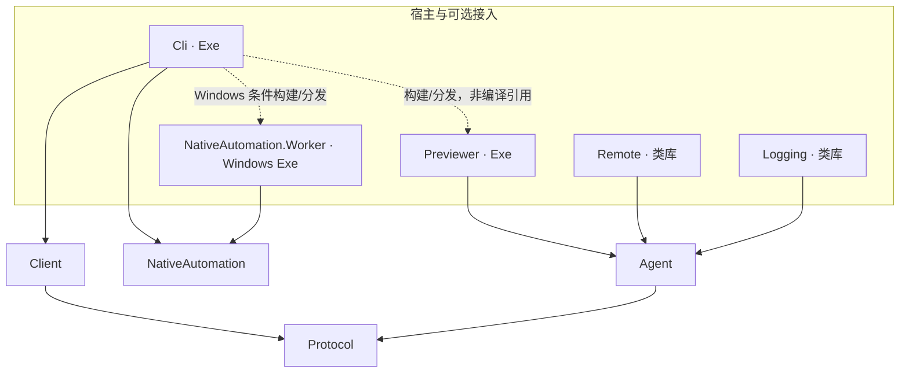

# 项目清单与依赖

本页记录当前解决方案中的真实项目、直接引用和运行资产。本轮目录与职责重构见[结构记录](refactoring-blueprint.md)，调用路径见[架构总览](../architecture.md)。

## 依赖图的读法

- **编译引用**：`ProjectReference` 的输出进入调用项目的编译引用；图中用实线单向箭头。
- **构建与分发**：依赖另一个项目的产物，但 `ReferenceOutputAssembly=false`；用虚线箭头。
- **进程通信**：运行时通过管道或 IPC 交互；在运行图中单独绘制。
- **第三方依赖**：包引用或 FrameworkReference，不与仓库项目引用混淆。

NativeAutomation.Worker 编译引用 NativeAutomation 的契约；NativeAutomation 在运行时启动 worker。两种关系方向不同，不构成编译循环。

## 九个生产项目

名称省略 `AvaloniaDevTool.`；未覆盖的 TFM 继承 [Directory.Build.props](../../Directory.Build.props) 的 net10.0。

| 项目 | 形态 / TFM | 直接编译项目引用 | 主要外部依赖或运行职责 |
| --- | --- | --- | --- |
| [Protocol](../../src/AvaloniaDevTool.Protocol/AvaloniaDevTool.Protocol.csproj) | 类库 / net10.0 | 无 | DTO、RpcPeer、源生成 JSON、trace；声明 IsAotCompatible |
| [Agent](../../src/AvaloniaDevTool.Agent/AvaloniaDevTool.Agent.csproj) | 类库 / net10.0 | Protocol | Avalonia、XAML Loader；加载在目标应用或 Previewer 内 |
| [Client](../../src/AvaloniaDevTool.Client/AvaloniaDevTool.Client.csproj) | 类库 / net10.0 | Protocol | 独立类型化 RPC 消费 SDK；不引用 Agent |
| [NativeAutomation](../../src/AvaloniaDevTool.NativeAutomation/AvaloniaDevTool.NativeAutomation.csproj) | 类库 / net10.0 | 无 | native DTO、worker IPC、目标身份、文件弹窗控制器 |
| [NativeAutomation.Worker](../../src/AvaloniaDevTool.NativeAutomation.Worker/AvaloniaDevTool.NativeAutomation.Worker.csproj) | Exe / net10.0-windows7.0 | NativeAutomation | FlaUI.UIA3、WinForms、Windows API；独立隔离进程 |
| [Previewer](../../src/AvaloniaDevTool.Previewer/AvaloniaDevTool.Previewer.csproj) | Exe / net10.0 | Agent | Avalonia Desktop、Headless、Fluent、XAML Loader；独立设计期宿主 |
| [Remote](../../src/AvaloniaDevTool.Remote/AvaloniaDevTool.Remote.csproj) | 类库 / net10.0 | Agent | Microsoft.AspNetCore.App；可选认证 WebSocket 接入 |
| [Logging](../../src/AvaloniaDevTool.Logging/AvaloniaDevTool.Logging.csproj) | 类库 / net10.0 | Agent | Microsoft.Extensions.Logging；可选 ILoggerProvider |
| [Cli](../../src/AvaloniaDevTool.Cli/AvaloniaDevTool.Cli.csproj) | Exe / net10.0 | Client、NativeAutomation | ModelContextProtocol 与其 ASP.NET Core 传输组件；stdio/HTTP 两种宿主 |

**结论：6 个生产类库、3 个生产 Exe；Cli 没有直接编译引用 Agent、Previewer 或 worker。**

Cli 引用 Microsoft.AspNetCore.App 以承载 HTTP；framework-dependent 分发的 stdio 模式也需要对应 ASP.NET Core Runtime。Windows worker 另需 Windows Desktop Runtime。该运行依赖没有传播到核心 Agent/Client/Protocol 项目。



### Cli 的运行资产

[Cli.csproj](../../src/AvaloniaDevTool.Cli/AvaloniaDevTool.Cli.csproj) 对 Previewer、Windows worker 使用 `ReferenceOutputAssembly=false`，构建后与发布后复制到：

```text
Cli 输出目录/
├─ AvaloniaDevTool.Cli.dll
├─ AvaloniaDevTool.Client.dll
├─ AvaloniaDevTool.Protocol.dll
├─ AvaloniaDevTool.NativeAutomation.dll
├─ 其他宿主依赖、deps.json、runtimeconfig.json
├─ previewer/
│  └─ AvaloniaDevTool.Previewer.dll 及其全部运行依赖
└─ native-worker/
   └─ AvaloniaDevTool.NativeAutomation.Worker.dll 及其运行依赖
```

这是部署角色示意，不是完整逐文件清单。worker 只在 Windows 宿主/目标 RID 条件下构建分发，非 Windows RID 不携带它。

`SkipGetTargetFrameworkProperties=true` 避免对 worker 重复目标框架求值造成构建实例竞态；不要在整理目录时无依据地改写构建属性。第三方许可随对应项目分发，Agent 与 Cli 的同名许可使用不同 TargetPath。

## 三个样例项目

| 项目 | 引用 | 用途与接入差异 |
| --- | --- | --- |
| [AutomationSample](../../samples/AvaloniaDevTool.AutomationSample/AvaloniaDevTool.AutomationSample.csproj) | Agent | 真实多窗口、模态、原生文件弹窗和文档字节读写的研发目标；Debug/Release 都挂 Agent |
| [Sample](../../samples/AvaloniaDevTool.Sample/AvaloniaDevTool.Sample.csproj) | Agent、Logging、Remote | 绑定、资源、日志、诊断等 SDK 消费回归；默认仅 Debug 挂 Agent |
| [AotSample](../../samples/AvaloniaDevTool.AotSample/AvaloniaDevTool.AotSample.csproj) | Agent | 最小 trimmed/AOT 消费目标；实际发布后的消费由 AotSmoke 验证 |

样例说明“怎样消费 SDK”，不是核心实现；AutomationSample 的业务状态只用于研发验证，不成为通用工具的业务规则。

## 六个测试项目

| 项目 | 直接编译引用 | 主要验证边界 |
| --- | --- | --- |
| [Agent.Tests](../../tests/AvaloniaDevTool.Agent.Tests/AvaloniaDevTool.Agent.Tests.csproj) | Agent、Client、Logging | 实际 Avalonia/Skia、UI 线程、属性绑定恢复、资源、输入和服务清理 |
| [Cli.Tests](../../tests/AvaloniaDevTool.Cli.Tests/AvaloniaDevTool.Cli.Tests.csproj) | Cli、Agent、Remote | 生产 stdio 子进程、initialize/tools/list/tools/call、媒体、目标切换、预览和 native 编排 |
| [Protocol.Tests](../../tests/AvaloniaDevTool.Protocol.Tests/AvaloniaDevTool.Protocol.Tests.csproj) | Protocol、Client | 帧、分片、取消、断开、源生成 JSON/AOT、trace 与 WebSocket Stream |
| [Previewer.Tests](../../tests/AvaloniaDevTool.Previewer.Tests/AvaloniaDevTool.Previewer.Tests.csproj) | Previewer | 项目与 App 上下文、跨程序集 XAML、监视/重载、失败保留与 PNG |
| [Remote.Tests](../../tests/AvaloniaDevTool.Remote.Tests/AvaloniaDevTool.Remote.Tests.csproj) | Remote、Client | 认证、Origin、TLS、共享连接门与清理 |
| [NativeAutomation.Tests](../../tests/AvaloniaDevTool.NativeAutomation.Tests/AvaloniaDevTool.NativeAutomation.Tests.csproj) | NativeAutomation | UIA/OS 输入、目标和节点身份、owned 模态、worker、路径与文件弹窗 |

额外构建/测试资产关系也需要保留：

- Cli.Tests 只构建 PreviewFixture 与 AutomationSample，不将其作为普通编译依赖。
- NativeAutomation.Tests 在 Windows 条件下只构建 Worker 与 NativeAutomation.Fixture，并链接部分 worker 几何/生命周期源文件做针对性断言。
- Previewer.Tests 将 Sample 的 PreviewCard.axaml 作为测试资产复制；它不因此依赖 Sample 的完整运行环境。

这些关系解释了“为什么删掉一个似乎不用的项目或源文件，会破坏另一层测试”。重构时以实际引用与独特行为覆盖核对，而不是只按名称归并。

## 四个测试支撑项目

| 项目 | 形态与引用 | 唯一用途 |
| --- | --- | --- |
| [PreviewFixture](../../tests/AvaloniaDevTool.PreviewFixture/AvaloniaDevTool.PreviewFixture.csproj) | Avalonia 应用；引用 PreviewFixture.Controls | 真实 classful XAML、项目/App 上下文目标 |
| [PreviewFixture.Controls](../../tests/AvaloniaDevTool.PreviewFixture.Controls/AvaloniaDevTool.PreviewFixture.Controls.csproj) | 控件类库；无仓库项目引用 | 跨程序集自定义控件加载 |
| [NativeAutomation.Fixture](../../tests/AvaloniaDevTool.NativeAutomation.Fixture/AvaloniaDevTool.NativeAutomation.Fixture.csproj) | Windows WinForms Exe；无仓库项目引用 | 独立 UIA、HWND 生命周期、文件弹窗、输入与模态目标 |
| [AotSmoke](../../tests/AvaloniaDevTool.AotSmoke/AvaloniaDevTool.AotSmoke.csproj) | Exe；引用 Client | 独立驱动实际发布的 AotSample，禁用 JSON reflection fallback |

AotSmoke 是可执行消费验证程序，不是第七个测试框架项目。Fixture 不进入普通产品分发。

## 构建入口与目录约束

- [AvaloniaDevTool.slnx](../../AvaloniaDevTool.slnx) 是 22 项目的权威解决方案清单。
- [Directory.Build.props](../../Directory.Build.props) 固定共同 TFM、Nullable、ImplicitUsings、语言版本、Avalonia 版本和 warnings-as-errors。
- [global.json](../../global.json) 要求 SDK 10.0.100，并允许 latestFeature roll-forward；它不表示本机解析到的 SDK 一定是 10.0.100。
- [tests/scripts/Test-NativeAot.ps1](../../tests/scripts/Test-NativeAot.ps1) 执行真实发布后的消费链；兼容警告模式和严格模式有不同证明范围。
- [.editorconfig](../../.editorconfig) 要求 UTF-8、LF、文件末尾换行和无行末空格。
- [.gitignore](../../.gitignore) 区分 bin/obj/artifacts 等本地产物；这些目录不是领域模块。

构建/启动步骤见[架构导航](../architecture.md#项目怎么启动起来)，测试的复现命令、桌面条件和证据范围见[测试说明](../testing.md)。

## 结构变更的影响判断

| 改动 | 需要核对 |
| --- | --- |
| 移动源码文件但保持类型与命名空间 | 编译、显式 Compile/Link、测试资产复制、文档链接与索引导航 |
| 修改公开 C# 类型/方法名 | Client/Agent 的真实 C# 调用方、样例、测试、序列化类型注册 |
| 修改 wire 方法名或 DTO 语义 | Agent/Client 双端、JSON 元数据、版本兼容、通知与传输测试 |
| 修改 MCP 工具名、参数或输出 | 工具目录、profile 选择、现有 MCP 消费方式和真实 stdio 测试 |
| 移动可执行项目或产物目录 | Cli 的 build/publish 复制、进程定位、worker/previewer 启动与回收 |
| 合并或删除入口分类 | 先确认独有功能、共享机制与验证都已有新归属，再删纯兼容壳 |
