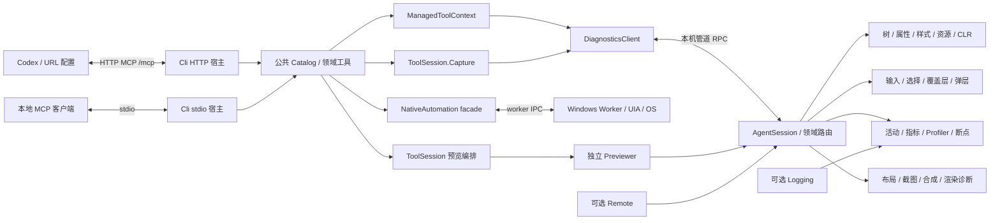
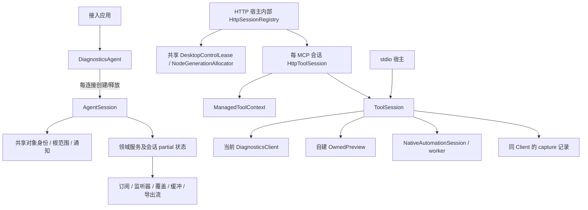

# 项目结构与本轮重构记录

状态：**本轮结构迁移与内网 HTTP MCP 入口已落地**。本文记录实际代码位置、职责和仍待改进的边界；保留原文件名以兼容既有链接。

保留现有 9 个生产项目、原有公开 API 与运行契约。源码已按领域物理归档，部分混合文件已薄拆，Agent 会话职责、共享 managed 上下文及 MCP 宿主组合已提取。
这不表示所有服务都已重写为独立类：现有 partial、功能算法和生命周期状态按下文保留，未增加动态插件框架或每工具一个项目。
运行细节见[运行契约](runtime-contracts.md)，完整清单见[项目清单](project-inventory.md)，扩展示例见[新增工具](extending-tools.md)。

主部署仍是 Codex 在电脑 B、Avalonia 与完整执行端在电脑 A。HTTP MCP 已实现，实际本机 Codex 和 WSL 路径已有烟测；**真实独立双机尚未验收**。
B 通过标准 MCP URL 配置连接已运行的 A 服务；A 上 Client → Agent 继续走管道，native/preview/capture 仍在 A。配置与验证边界见[内网 MCP](lan-mcp-design.md)。

## 1. 已落地的执行关系



图中表示执行关系。项目引用仍遵循第 5 节；managed 与 native 保留独立 gate，采集协调复用当前 DiagnosticsClient。
HTTP 首版提供 `agent` 的 44 项工具；stdio 保留 `agent/official/extended`。历史 profile 壳负责兼容聚合，核心领域按能力组织。

## 2. 九个生产项目的实际目录

### AvaloniaDevTool.Agent：目标应用内执行与诊断

```text
Hosting/                         DiagnosticsAgent、接入选项、pipe 与共享连接入口
Sessions/                        AgentSession 组合、同步路由、异步入口、观察周期
  Identity/                      WeakObjectRegistry
  Targets/                       根窗口/owned popup 范围及 RootHandlers
  Notifications/                 会话通知出口
Features/
  Tree/                          三种树、搜索、分页、selector、观察与探索入口
  Properties/                    属性读取/编辑、brush、context、预览 lease
    Presentation/                值转换、编辑器描述、错误展示
  Styles/                        样式/绑定读取和同步路由
  Resources/ Assets/             资源作用域/编辑、资产/元数据/分块导出
  Input/ Selection/ Overlays/     框架输入、选择/高亮、覆盖层
  Layout/ Rendering/ Popups/      几何、图像/合成/renderer flags、弹层冻结
  Runtime/                       只读 CLR 成员及集合
  Diagnostics/
    Activity/ Metrics/           日志/事件/活动、Meter 采集与历史
    Profiler/ Breakpoints/        性能监听、断点订阅及历史
Framework/Avalonia12/             固定版本的私有 API 适配
Logging/                         日志源接入契约
ThirdParty/                      第三方许可
```

[AgentSession.cs](../../src/AvaloniaDevTool.Agent/Sessions/AgentSession.cs) 现负责服务组合、连接入口与统一释放，主文件约 114 行。
[AgentSession.Routing.cs](../../src/AvaloniaDevTool.Agent/Sessions/AgentSession.Routing.cs) 显式组合 17 个领域的 74 条同步 RPC；各域在自己的 partial 中登记方法。
`Map<TRequest>` 仅在调用时反序列化；23 条无参数路由继续忽略 payload。大小写、null/未知方法 fallback、UI 线程检查和 disposed 检查保持原规则。
[异步入口](../../src/AvaloniaDevTool.Agent/Sessions/AgentSession.Async.cs) 的 Composition 特例与原 HandleExploration fallback 保留。

这次实际抽出了以下职责与状态，方法体及原有执行顺序保持：

| 职责 | 实际位置 |
| --- | --- |
| GetRoots/GetChildren/Describe/ChildObjects、MergedTree 字段 | [Tree](../../src/AvaloniaDevTool.Agent/Features/Tree/AgentSession.Tree.cs) |
| 属性元数据、读取/编辑/清除、`_overrides` | [PropertyEditing](../../src/AvaloniaDevTool.Agent/Features/Properties/AgentSession.PropertyEditing.cs) |
| picking、高亮、指针/键盘选择处理 | [Selection](../../src/AvaloniaDevTool.Agent/Features/Selection/AgentSession.Selection.cs) |
| 共享 Observe、属性/模板变化、OnTick 与 pending 集合 | [Observation](../../src/AvaloniaDevTool.Agent/Sessions/AgentSession.Observation.cs) |
| 根发现、owned popup 补充、根事件订阅 | [Roots](../../src/AvaloniaDevTool.Agent/Sessions/Targets/AgentSession.Roots.cs) |
| Notify、通知发送与 peer 字段 | [Notifications](../../src/AvaloniaDevTool.Agent/Sessions/Notifications/AgentSession.Notifications.cs) |

这些仍是同一 AgentSession 的 private partial 状态，没有另建 SessionContext 或复制对象注册表。
现有独立服务继续由会话拥有；本轮没有改变属性覆盖算法及其已记录的 TextBox 限制。

### AvaloniaDevTool.Client：类型化 RPC 消费入口

```text
Connections/                     DiagnosticsClient 的连接、握手、通知与释放；Remote 适配
Capture/                         同一 Client 的 mutation epoch/所有权原语
Features/
  Tree/ Properties/ Styles/       类型化查询与修改方法
  Resources/ Assets/ Runtime/     资源作用域、资产与 CLR 查看
  Input/ Selection/ Overlays/     输入/动作、焦点、高亮相关调用
  Layout/ Rendering/ Popups/      布局、截图、合成、渲染与弹层
  Diagnostics/                   Activity/Metrics/Profiler/Breakpoints
  Preview/                       内容代际相关调用
```

[DiagnosticsClient](../../src/AvaloniaDevTool.Client/Connections/DiagnosticsClient.cs) 的公开 partial API 保留。
原 Exploration/Inspection 混合方法已薄拆到 Tree、Selection、Styles、Resources、Assets、Input、Rendering 等领域，仍委托同一 RPC peer。
例如[树查询](../../src/AvaloniaDevTool.Client/Features/Tree/DiagnosticsClient.Tree.cs)、[资源作用域](../../src/AvaloniaDevTool.Client/Features/Resources/DiagnosticsClient.ResourceScopes.cs)、[资产查看](../../src/AvaloniaDevTool.Client/Features/Assets/DiagnosticsClient.AssetInspection.cs)。
连接主文件仍保留少量基础树/属性/选择调用；目录归域没有变成多个独立客户端或新服务对象。
Client 不处理 MCP 参数、不启动预览或 worker；完整采集编排仍在 Cli。

### AvaloniaDevTool.Protocol：共享契约、序列化与 RPC 基础

```text
Contracts/
  Session/ Tree/ Properties/      会话身份、树与属性 DTO/方法名
  Styles/ Resources/ Assets/      绑定、资源与资产契约
  Input/ Selection/ Overlays/     输入、选择与覆盖层
  Layout/ Rendering/ Popups/      几何、图像/合成、渲染与弹层
  Runtime/ Diagnostics/ Preview/  CLR、诊断采集、断点、预览
Serialization/                   ProtocolJson、源生成 JSON context
Transport/                       RpcPeer、RpcException 与帧/请求处理
  WebSockets/                    RpcWebSocketStream
Tracing/                         RpcTrace 观察模型
```

原 Contracts.cs 已拆成[会话](../../src/AvaloniaDevTool.Protocol/Contracts/Session/SessionContracts.cs)、[树](../../src/AvaloniaDevTool.Protocol/Contracts/Tree/TreeContracts.cs)、[属性](../../src/AvaloniaDevTool.Protocol/Contracts/Properties/PropertyContracts.cs)、[选择](../../src/AvaloniaDevTool.Protocol/Contracts/Selection/SelectionContracts.cs)及独立序列化/错误定义。
`Methods` 通过 partial 保留原公开名称，DTO 语义与 JSON 元数据没有因目录变化重定义。
Protocol 继续不引用 Avalonia、MCP、ASP.NET Core 或 Windows UIA；DTO 与 RPC 共处原项目。

### AvaloniaDevTool.Cli：宿主、工具适配与进程编排

```text
Hosting/
  Program.cs                     启动参数入口与模式选择
  Options/                       McpHostOptions：命令行/服务端配置解析
  Stdio/                         StdioMcpHost
  Http/                          HttpMcpHost 与内部 HttpSessionRegistry
Catalog/                         McpToolCatalog：工具创建、profile、schema 过滤
Tools/
  OfficialTools.cs                canonical 兼容聚合类
  AgentTools.cs / InspectorTools.cs  交互与扩展兼容聚合类
  Connection/ Preview/ Tree/      附加/发现、文件预览、树与搜索
  Properties/ Resources/ Assets/  属性/样式适配、资源、媒体与资产
  Input/ Overlays/                managed 输入、等待、覆盖层
  Rendering/ Popups/ Runtime/     图像/合成/渲染、弹层与 CLR
  Diagnostics/                   Activity/Metrics/Profiler/Breakpoints/Capture
  Native/ FileDialogs/            原生与真实文件弹窗入口
Sessions/                        ToolSession、ManagedToolContext、HttpToolSession
                                 DesktopControlLease、NodeGenerationAllocator
Connections/                     ToolSession.Discovery
Preview/                         ToolSession.ProjectPreview、项目评估与构建
Native/                          ToolSession.Native、worker 会话关联
Capture/                         ToolSession.Capture、采集结果与归属协调
Contracts/                       MCP 专用结果及当前兼容输入声明
ThirdParty/                      CLI 依赖许可
```

[ManagedToolContext](../../src/AvaloniaDevTool.Cli/Sessions/ManagedToolContext.cs) 已从 OfficialTools 提取 managed 调用门、错误映射、公开节点编解码和前后内容代际检查。
AgentTools 通过该上下文执行 managed 操作，保留旧构造的薄兼容适配；[树查询](../../src/AvaloniaDevTool.Cli/Tools/Tree/ManagedTreeQueries.cs)和[属性查询](../../src/AvaloniaDevTool.Cli/Tools/Properties/ManagedPropertyQueries.cs)供工具与 UiWait 共用。
[McpToolCatalog](../../src/AvaloniaDevTool.Cli/Catalog/McpToolCatalog.cs) 供两个宿主共用，HTTP 只启用 agent，stdio 保留三个 profile。

HTTP 的实际组合与所有权为：

| 实现 | 实际职责 |
| --- | --- |
| [HttpMcpHost](../../src/AvaloniaDevTool.Cli/Hosting/Http/HttpMcpHost.cs) | `/mcp`、监听、SDK 协议模式、HTTP 请求边界 |
| HttpMcpHost 内部 HttpSessionRegistry | pending/active MCP 会话登记、共享宿主级 lease/代际分配器；没有独立 McpSessionRegistry 文件 |
| [HttpToolSession](../../src/AvaloniaDevTool.Cli/Sessions/HttpToolSession.cs) | 每会话 ToolSession/Context、活跃调用、闲置租约、幂等关闭；没有独立 McpSessionLifetime 文件 |
| [DesktopControlLease](../../src/AvaloniaDevTool.Cli/Sessions/DesktopControlLease.cs) | 一个宿主同时一个活动控制者，按 owner/句柄核验释放 |
| [NodeGenerationAllocator](../../src/AvaloniaDevTool.Cli/Sessions/NodeGenerationAllocator.cs) | 宿主运行期内不复用 managed 节点代际；耗尽明确失败 |

[ToolSession](../../src/AvaloniaDevTool.Cli/Sessions/ToolSession.cs) 继续协调附加/切换和整体清理。
预览进程仍由同文件的 OwnedPreview 管理，native 与 capture 分别在对应 ToolSession partial；本轮未新增独立 PreviewProcessOwner、NativeSessionOwner 或 CaptureCoordinator 类。
网络地址属于宿主选项与 Codex 标准配置；工具业务参数不携带服务端 IP。

### AvaloniaDevTool.Previewer：独立设计期运行环境

```text
Hosting/                         Program、PreviewApp、PreviewOptions、PreviewControl
Projects/                        PreviewAssemblyScope 与依赖解析
Documents/                       PreviewDocumentLoader
Sessions/                        PreviewSession、成功内容代际
Watching/                        PreviewFileWatcher、防抖与 UI 调度
Presentation/                    PreviewWindow
```

[Hosting/Program.cs](../../src/AvaloniaDevTool.Previewer/Hosting/Program.cs) 仍包含 PreviewControl 的控制管道/父进程退出处理，尚未独立为 Lifetime 服务。
目录迁移保持既有加载算法；成功重载更新代际，失败保留上次视图，程序集改变仍需重建/重新附加。
Previewer 通过普通 Agent 暴露目标，不新增另一套诊断实现。

### AvaloniaDevTool.NativeAutomation：门面与流程编排

```text
Contracts/                       native 与文件弹窗 DTO
Sessions/                        NativeAutomationSession、目标身份及 worker 请求
Worker/                          NativeWorkerProtocol
FileDialogs/                     NativeFileDialogController
```

门面保持 net10.0，运行时核验平台；worker 启动/请求串行化/失效回收仍在 [NativeAutomationSession](../../src/AvaloniaDevTool.NativeAutomation/Sessions/NativeAutomationSession.cs)。
FileDialogs 复用该会话完成流程，未将 UIA 实现引入门面。

### AvaloniaDevTool.NativeAutomation.Worker：Windows 执行隔离

```text
Hosting/                         Program、IPC 分发与错误映射
Sessions/                        NativeAutomationBackend：目标、节点、UIA 查询/动作
Identity/                        NativeWindowLifetimeMonitor
Windows/                         NativeWindows
Input/                           原生输入及输入批次
Capture/                         截图、裁剪与几何
Coordinates/                     DPI/坐标换算
```

本轮主要是文件归域；[NativeAutomationBackend](../../src/AvaloniaDevTool.NativeAutomation.Worker/Sessions/NativeAutomationBackend.cs) 仍聚合节点注册、范围检查、树遍历与 pattern 动作。
尚未拆出独立 Automation/Identity 后端服务。UIA3、OS 输入与 Windows TFM 继续留在 worker；Cli 的 Windows JobObject 构建回收属于另一个平台边界。

### AvaloniaDevTool.Remote 与 AvaloniaDevTool.Logging：可选接入

```text
AvaloniaDevTool.Remote/
  Hosting/                       DiagnosticsRemoteServer
  Configuration/                 DiagnosticsRemoteServerOptions
AvaloniaDevTool.Logging/
  Providers/                     DiagnosticsLoggerProvider
```

[Remote](../../src/AvaloniaDevTool.Remote/Hosting/DiagnosticsRemoteServer.cs) 继续把认证后的 WebSocket 流交给已有 Agent，`/diagnostics` 及原 Token/TLS/Origin 规则保持。
[Logging provider](../../src/AvaloniaDevTool.Logging/Providers/DiagnosticsLoggerProvider.cs) 继续适配应用 ILogger/Scope；二者没有变成 Agent 的必选依赖。

## 3. 仓库支撑与仍保留的混合边界

| 位置 | 本轮处理与边界 |
| --- | --- |
| solution、Directory.Build.props、global.json | 保留 9 个生产项目与既有公共构建约定；HTTP 宿主在 Cli 增加必要依赖 |
| tests/ 与支撑 fixture | 保留原项目和行为覆盖，补参数、上下文、会话、HTTP 与 Agent 路由回归；未删除上游测试来消除失败 |
| samples/ | 保留最小接入、真实自动化/文件流程、AOT 消费路径 |
| docs/ | 结构、运行契约、扩展路径与验证记录分开维护，历史证据仍标明适用范围 |
| artifacts/ | 临时验证材料与生成产物，遵循现有忽略/清理规则，不作为运行依赖 |
| .codegraph/ | 使用已有索引导航；本轮没有将重新建索引或升级作为重构前提 |

归档后的文件名仍可能承载相邻能力，例如 AgentSession.Exploration 包含伪类/动作，OfficialProperties 包含样式读取，Cli 的 OfficialTools.InputMedia 涉及输入/资源/媒体。
这些保留文件与算法已明确归主目录；不因路径归档声称每个方法都已独立成域服务。后续按真实变更成本逐步薄拆，保持兼容聚合入口。

## 4. 状态、资源与释放所有权



| 状态/资源 | 实际所有者与释放边界 | 保留约束 |
| --- | --- | --- |
| Agent 监听、连接、Session/Peer/Stream | 应用拥有 Agent；每次连接结束释放自己的 Session | pipe 与 Remote 共用连接预留；目标 UI 访问在 UI 线程 |
| HTTP 会话与桌面控制权 | 内部 registry 拥有会话；HttpToolSession 等待活跃调用退出、清理目标后释放 lease | 按 MCP 会话关联；session ID 不是认证身份；不按来源 IP 合并会话 |
| managed 调用门、公开节点 | 每 ToolSession 的 ManagedToolContext；HTTP 宿主共享代际分配器 | 前后检查连接引用和内容代际；native 不拿 managed gate；重启后丢弃旧 ID |
| 内部对象 ID、根与变化通知 | 当前 AgentSession 共用 WeakObjectRegistry、观察与根 partial | 弱引用、跨树身份一致；Observe 与事件订阅仍共享一个会话 |
| 属性/brush/伪类临时修改 | 当前属性/探索状态；Session 按原顺序释放 | 保留绑定与现有恢复算法；已模板化 TextBox 的窄限制仍适用 |
| 资源、renderer flags、弹层冻结 | 对应 Resources/Rendering/Popups 服务 | 只恢复自己仍拥有的修改，保留应用后来写入的值 |
| 日志/事件/Meter/Profiler/断点 | 对应 Diagnostics 服务 | 服务拥有 listener、timer、订阅与有界缓冲；停止与清历史语义区分 |
| capture ID、epoch 与快照 | ToolSession.Capture；Client 提供 mutation epoch 原语 | 复用同一 Client，只停止自己拥有的监听，连接变更使旧归属失效 |
| 资产流/hash/过期计时器、图像资源 | Assets 服务或单次采集调用 | close/过期/断开释放；保留字节/像素/输出预算 |
| 外部应用、自建预览、worker | 外部应用由用户拥有；ToolSession 只拥有自己创建的进程/会话 | detach 不终止外部目标；失败/取消/退出清理自建进程 |
| UIA 节点、HWND 生命周期、OS 输入状态 | worker Backend 与窗口生命周期监视器 | PID/start time/owner/runtime ID 校验；超时/取消使 native 会话失效 |
| Remote host、日志 provider | 接入应用拥有，领域服务借用连接/订阅 | 断开诊断不销毁应用日志系统；Remote 不释放注入的 Agent |

观察周期、根发现和 Dispose 的原顺序保持。取消只结束可取消的等待，不能强制中止已进入 UI 的同步 getter 或控件处理器。
UI、后台采样、合成渲染线程和 Windows worker 继续各有执行边界；本轮没有用一个公共异步包装或全局锁替代它们。

## 5. 依赖与扩展规则

1. Protocol 承载 DTO、源生成序列化与 RPC 基础；新增类型继续核对 JSON context，迁移不改变 AOT 回退规则。
2. Agent、Client 依赖 Protocol，Client 不依赖 Agent。Agent 不依赖 Cli、MCP、Remote 或 Logging 项目。
3. Cli 依赖 Client、NativeAutomation 与 MCP 宿主能力；Previewer/Worker 保留分发依赖，非编译引用仍须打包。
4. Previewer、Remote 复用 Agent；Logging 经已有日志源接口接入；Windows UIA 与 Windows TFM 保持在 worker。
5. 工具入口通过共享上下文或领域用例复用能力；AgentTools 不再通过 OfficialTools 对象借 managed 基础设施。
6. 支撑机制按变化原因和所有权归档：值展示归 Properties，坐标归 native Coordinates，缓冲归 Diagnostics，版本探测归 Framework。

新增工具先查看所属 Cli/Tools 领域与已有类型化 Client API；能组合完成时只新增薄工具与 Catalog 注册。
需要新 managed 能力时贯通 Protocol DTO → Agent 领域实现/注册 → Client 方法 → Cli 工具；新 native 能力继续走 facade/worker。
具体步骤与示例见[新增工具](extending-tools.md)。每次扩展都要交代执行域、身份、预算、恢复与验证入口。

## 6. 本轮已完成事项与验证

| 事项 | 实际结果 |
| --- | --- |
| 九项目源码归域 | 完成物理目录迁移；保留原公开 API/namespace、项目和功能算法 |
| 混合源码薄拆 | Protocol 公共 Contracts、Client Exploration/Inspection 分到对应领域，保持既有调用语义 |
| managed 基础设施 | 提取 ManagedToolContext/NodeGenerationAllocator，共享领域查询；历史构造保持兼容 |
| 工具与宿主组合 | 公共 McpToolCatalog、独立 Stdio/HTTP 宿主、统一选项解析已实现 |
| HTTP 会话所有权 | per-session ToolSession、内部 registry、控制 lease、闲置/关闭与失败回滚已实现 |
| Agent 职责提取 | 主组合收缩、74 同步路由/17 领域注册，树/属性/选择/观察/根/通知分归职责文件 |
| 构建与专项验证 | Debug/Release 全 solution 构建均零警告零错误；Agent 路由/相关既有检查、CLI/HTTP/native 真实文件闭环已通过 |
| 实际客户端烟测 | 本机 Codex 与 WSL 访问路径已有证据；真实独立双机未验 |

测试分批之间存在覆盖重叠，不在此累加总数。最终批次、命令和实际限制以[测试说明](../testing.md)为准。
新 [Agent 路由回归](../../tests/AvaloniaDevTool.Agent.Tests/AgentSessionRoutingTests.cs)检查忽略 payload、惰性解析、未知/null fallback、异步回退、线程及释放检查顺序。

## 7. 后续工作与本轮未解决事项

- 真实独立 A/B 双机端到端验证尚未完成；本机、WSL 和内网地址烟测不替代它。
- Agent 仍以同一 partial 会话共享状态，部分服务和工具文件仍跨相邻能力；后续在实际变化或测试隔离需要处继续提取。
- 独立 PreviewProcessOwner、CaptureCoordinator、NativeSessionOwner，以及 worker 内更细 Automation/Identity 服务均未在本轮新增。
- Client 连接主文件仍有基础功能转发；继续拆分时保留单连接身份、通知与采集所有权。
- HTTP 后续工具目录扩展另行决定；stdio 的兼容 profile 继续可用，本轮未删除旧能力。
- 严格 AOT、其他平台及跨主机能力没有因结构移动自动获得新证明，参照[Native AOT](../native-aot.md)及测试说明单列。
- Avalonia 12.1.4 已模板化 TextBox 的初始 LocalValue 动画覆盖释放限制仍存在；没有采用无条件写回或 ClearValue 破坏原绑定/应用后写。

当前结构已让工具入口、RPC 契约、功能实现和生命周期位置可沿目录追踪；未来提取以真实调用者和资源归属为依据。
