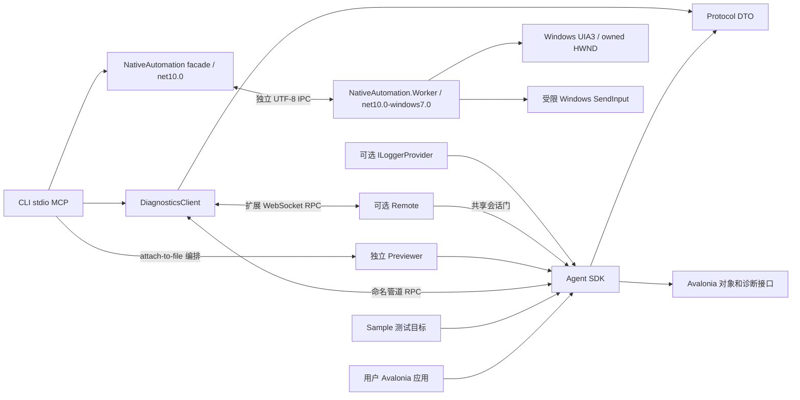

# 运行契约与边界

本页记录现有实现的详细运行约束。项目总览见[架构导航](../architecture.md)，目标结构见[重构蓝图](refactoring-blueprint.md)。

当前目标是自研 Agent 的 Windows 完整界面交互和真实原生文件流程。managed 执行链为目标内 Agent SDK → 内部 RPC → DiagnosticsClient → 独立 stdio MCP；native 执行链由 MCP → net10.0 facade → 独立 Windows worker → UIA/OS 输入组成。默认 `agent` profile 为 44 项工具；`official` 16 项和 `extended` 62 项显式保留。独立 Inspector、XamlMcpBackend 和共同 GUI 后端接口已退出本分支，历史桌面架构保存在 `main/fa1c623`。

## 模块和依赖

解决方案当前包含 22 项目：9 个生产、3 个样例、10 个测试/支撑项目。新增 AutomationSample 提供真实 Avalonia 多窗口、模态和 StorageProvider 文件读写；NativeAutomation.Tests/Fixture 提供独立 Windows native 与隔离进程验证。较早 GUI 收缩边界见 [范围审计](../agent-tools/architecture/scope-and-dependencies.md)，该历史审计的项目数不作为当前清单。

Agent 是核心消费 SDK。Previewer 是 `attach-to-file` 必需进程，分发到 `previewer/`；Windows worker 分发到 `native-worker/`。二者 `ReferenceOutputAssembly=false` 只表示不作为 CLI 编译引用，不表示可省略运行依赖。native facade 保持 net10.0；UIA3、Windows Forms 和 OS 输入仅进入 net10.0-windows7.0 worker，不把 Windows TFM 传播到核心协议/客户端。

worker 项目引用使用 `SkipGetTargetFrameworkProperties=true`，不再通过 AdditionalProperties 重复指定它已有的 TFM，以避免同一 worker 出现两个 MSBuild 实例造成并行构建竞态。`BuildNativeWorker` 按宿主/目标 RID 控制引用、构建和复制；非 Windows RID 不打包 worker。第三方许可文件分别使用 `ThirdParty/AvaloniaDevTool.Agent/`、`ThirdParty/AvaloniaDevTool.Cli/` TargetPath，避免发布文件同名冲突。Linux framework-dependent 交叉发布已验证，尚未 Linux 实际运行。

Protocol 不引用 Avalonia。跨进程传递 DTO、文本预览和弱对象 ID，不序列化业务对象图。Avalonia 对象访问在目标 UI 线程执行；日志、Meter 和 Activity 的后台回调使用各自有界缓冲区。Logging 和 Remote 是可选扩展，核心 Agent 不依赖 Microsoft 日志框架或 ASP.NET Core。

## 外层 MCP 传输

Cli 支持默认 stdio 和显式内网 HTTP。HTTP 端点为 /mcp、按当前要求无 Token，Codex 从标准 URL 配置连接；Client 到 Agent 仍是目标机本地管道，native worker 与预览仍在目标机。HTTP 首版为 agent44，历史 profile 保留 stdio。完整启动和控制会话见[内网部署](lan-mcp-design.md)。

SDK 协议 Session ID、Agent SessionInfo、managed 节点代际和 native 节点域是不同层的关联，不彼此替代。Host/Origin 与活动会话检查、十分钟闲置、单控制租约和资源清理在外层宿主实现，不修改下列内部 RPC 合同。

## 三个 MCP profile

CLI 通过 ModelContextProtocol 2.3.0 承载外部标准 stdio/HTTP MCP，标准输出只含协议，日志写入标准错误。默认 `agent` 注册 canonical16 + ui9 + native8 + file-dialog8 + capture3，共44项。显式 `official` 只注册 canonical 16；显式 `extended` 注册旧 InspectorTools 62 项独立诊断契约，不能当作 canonical 的兼容超集。

official 对有采样的 15 项使用归档输入声明，保留名字、类型、必填、默认、枚举及注解；`detach` 按公开文档另行实现。原版初始目录没有该项，何时动态出现尚未确认。本项目的输出 DTO、错误和本地选择策略有明确实现，但没有原版成功 `tools/call` 样本证明逐字段等价。依据见 [官方能力基准](../agent-tools/research/official-capabilities.md)，调用说明见 [MCP](../mcp.md)。

内部命名管道和 WebSocket 承载本项目 RPC，不是原版 DeveloperTools CoreRPC，也不是 CDP。保留的服务、RPC 或测试数量不扩大官方工具验收分母。

## 连接、身份和释放

Agent 默认监听 `avalonia-devtool-{进程 ID}`，命名管道限制当前用户。CLI 可通过启动参数 `--pipe` 配置首次读取时的附加目标；`attach-to-app {}` 列出可发现端点，使用列表返回的应用 `id` 选择，不能把它当 PID。发现不代表已成功握手，后续附加读取真实 `session.info`。

Agent 同时接受一个客户端。可选 Remote 与管道共享会话门；切换客户端前应先断开。内部连接时限 5 秒，单次请求时限 15 秒，协议版本不匹配时拒绝连接；框架依赖固定为 Avalonia 12.1.4，内部协议版本一致不证明任意 Avalonia 版本都兼容。

目标对象由会话弱注册表标识。canonical/ui-* 对外数值节点身份还编码连接代际和预览内容代际；切换应用、重连或成功重载 XAML 后，旧节点不能误用于新对象。调用应从当前 `tree/search` 重新取 ID。同一真实对象在三种树中保持身份；Merged 的模板组和内容插槽是明确标注的导航节点，不可作为属性、输入或截图目标。

native 使用独立 `native:<session>:<opaque-id>` 字符串域，核对附加目标 PID+UTC start time、HWND owner 链、根进程身份和 UIA runtime ID，并验证节点仍为所属根后代。它只覆盖目标和可验证 owned 窗口，拒绝任意桌面进程。旧节点、重用 PID/句柄、关闭或替换窗口均失败。

canonical/ui-* 持 managed call gate；native/file-dialog 不取得它，使用独立 worker IPC 请求 gate，文件修改动作再串行化。因此 managed 调用进入模态等待时仍可读取和回答 owned 原生窗口。UIA 模态动作可返回 pending/operationId，标准 Win32 按钮可返回 dispatched；业务结果必须另行观察。native 默认操作期限 15 秒，超时/取消使会话失效并回收自己的 worker，detach/切换/父进程退出也清理；下次操作重新枚举身份。完整层次与固定清单见 [完整 UI 自动化](../agent-tools/architecture/complete-ui-automation.md)。

断开释放本会话的属性覆盖、伪类修改、资源编辑、资产读取流、拾取与焦点监听、覆盖层、事件和日志订阅、指标、Profiler 监听及断点。外部附加应用不归 MCP 所有，不会被 detach 终止；自建预览由会话负责退出。临时覆盖保护原绑定和底层值，应用后来写入的冲突按各服务规则处理。

取消或超时结束等待，不能强行中止已经进入 UI 线程的同步 getter、控件处理器或指标回调。错误、取消和晚到响应不能被当作后续请求结果。

## 内部协议与预算

每条内部消息是四字节小端长度和 UTF-8 JSON 正文，正文范围 1 到 4 MiB。读写处理分片，写入串行化；非法长度、截断和断流结束会话并使等待请求失败。JSON 使用 camelCase，请求、响应和通知使用本项目 envelope，不宣称内部 wire 遵循 JSON-RPC 2.0；外部 MCP 由 SDK 处理。

`ProtocolJsonContext` 为协议 DTO、集合和 envelope 提供 System.Text.Json 源生成元数据。JIT 可在动态代码和反射序列化均启用时回退；Native AOT 没有未注册类型的反射回退。最小消费样例与严格无警告 AOT 发布是不同验收项，历史限制和脚本见 [Native AOT](../native-aot.md)。

WebSocket 扩展把二进制片段作为 RPC 流读取，消息边界不是 RPC 记录边界；拒绝 Text 和超限消息。默认 loopback，Bearer 认证与 Origin 检查在 upgrade 前完成；非 loopback 监听要求显式 TLS，客户端保留平台证书验证。此传输不属于默认官方 MCP 工具，详见 [远程传输](../remote-transport.md)。

各诊断域还有遍历、像素、字节、历史或通知预算。official 的关键限制包括：

| 能力 | 本地边界 |
| --- | --- |
| 树与父链 | 单次最多 100000 节点，超过明确失败；不会把不完整结果当完整子树 |
| 属性 XAML | 目标支持动态代码；XML 最多 1 MiB 字符，禁用 DTD；转换失败保留原覆盖 |
| 资源 | provider 和条目有独立上限，保留来源、重复键和截断状态，不伪造唯一胜出资源 |
| 资产 | 完整 MCP 响应最多 16 MiB 原始字节；底层分块导出和预览有独立预算 |
| 截图 | 最大边 2048、最多 2097152 像素、PNG 最多 1 MiB；超限报错，不静默缩小 |
| 输入 | Avalonia 框架路由，不是 OS 注入或 IME；四种官方事件映射到真实目标行为 |

参数、具体输出和剩余未知分别见 [树与搜索](../agent-tools/tree-search.md)、[属性与操作](../agent-tools/features/properties.md)、[输入资源媒体](../agent-tools/features/input-media.md)。

## 设计期预览

official `attach-to-file` 从 `xamlFilePath/xamlProjectPath` 评估真实 MSBuild 项目，读取 TargetPath 和兼容 TFM；默认不构建，`build=true` 实际构建成功后才启动 Previewer。产物选择是本项目明确策略，官方默认配置和多 TFM 选择尚未取得运行对照。

Previewer 设置设计模式，初始化项目 App 资源、主题和自定义控件，保留 `x:Class`，不调用目标 `Main`。源文件保存后防抖重载；非法保存保留最后成功视图，成功重载使旧节点失效。程序集和依赖改变需重建并重新附加，不能视为任意 IDE 设计进程接入。

CLI 经控制管道等待初次加载、Agent 就绪和 PID 握手；取消、失败、超时、切换、detach 和正常退出清理自建预览。父 MCP 异常退出也由控制管道触发回收；Windows 构建进程有作业对象保护，其他系统构建阶段的父进程异常退出保护仍有限制。完整合同与测试入口见 [文件预览](../agent-tools/features/preview.md)。

## 扩展服务与历史证据

资源编辑、日志、指标、Profiler、断点、几何、合成采集、覆盖层、渲染诊断、弹层冻结和只读 CLR 服务仍有 Agent/Client 或 extended 调用与测试，不能按原 GUI 面板名称整体删除；也不能以它们补足官方工具缺项。旧文档保留服务预算、恢复和来源，Inspector 操作及旧桌面证据只适用于 `fa1c623`。

原生文件弹窗、UIA 和受限 Windows OS 输入已经加入自研目标；它们不属于官方兼容 16 项。真实文件验收必须独立检查应用文档、磁盘字节/hash及重新打开，不能以 picker 关闭或输入投递回执推导读写成功。框架输入、OS 输入、IME 和文件 DragDrop 的证据分开，native 当前仅限本机 Windows，remote 不可用。

原版许可运行对照属于兼容研究历史材料，不是当前自研 Agent 的运行前置条件。跨平台、跨主机和严格 AOT 的证明继续单列。[实现状态](../implementation-status.md) 与 [测试说明](../testing.md) 只承认与对应源码匹配的证据；当前验证结果以测试说明及对应源码证据为准，不沿用旧测试总数或百分比。

当前产品边界以[能力范围](../agent-tools/architecture/current-agent-scope.md)为准：提供基础操作、真实PNG和原始诊断；业务判断由调用方负责。managed区域截图在Agent内按本地DIP渲染，native截图在隔离worker中从目标PrintWindow表面按物理像素裁剪；二者不截任意桌面。Capture协调器复用同一DiagnosticsClient，以连接身份、服务CaptureId和同Client变更epoch保护采集归属，返回原始DTO、冻结/损失/错误状态。最新验证见[测试说明](../testing.md)。
